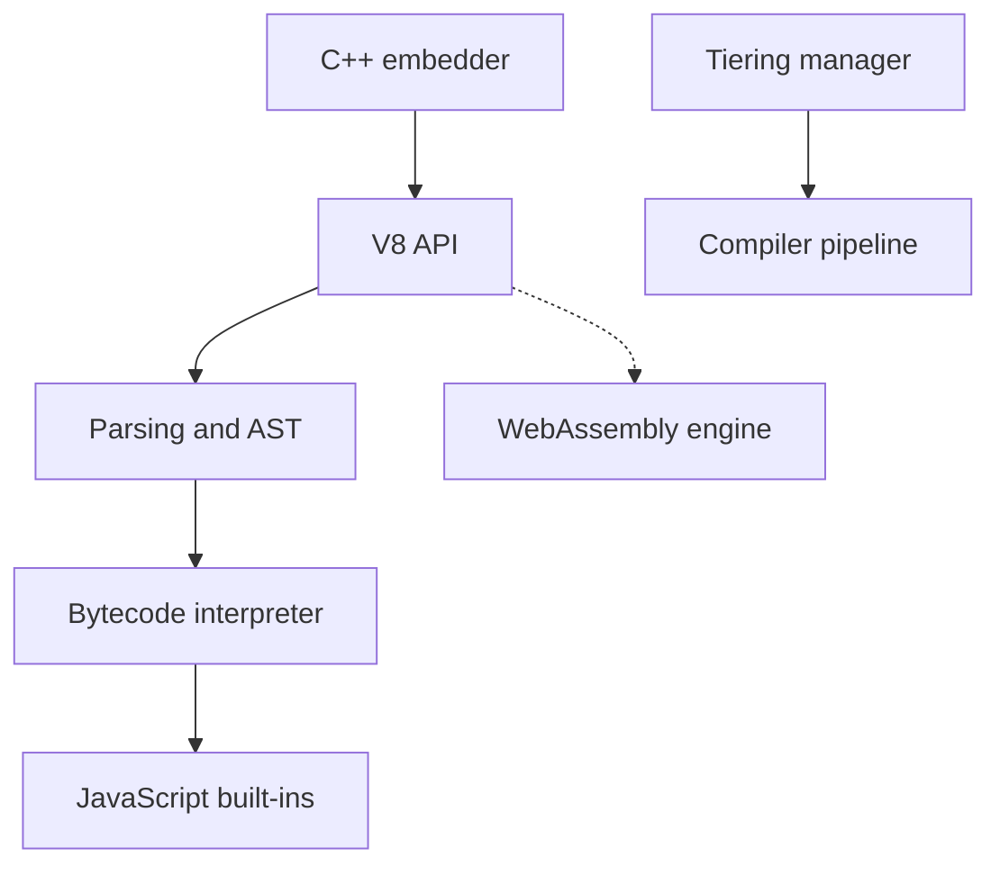

# v8/v8

> Google's JavaScript and WebAssembly engine, used in Chromium and embeddable in a C++ application.

## The problem
Running JavaScript inside a native application requires an engine able to interpret and optimize it.

## What it actually does
Implements ECMAScript (ECMA-262), written in C++. Can be used standalone or embedded through the public API. Parses the code, runs it as bytecode, compiles it with several optimization tiers (baseline, Turboshaft) and manages memory. WebAssembly support is visible in the code.

## How it is wired


## Trying it
```bash
fetch v8
git pull origin
gclient sync
```
Prerequisite: depot_tools installed.

## Cost and gotchas
Free. The license is present but not identified by GitHub. Fetching the code through depot_tools and building are long, with real disk and memory needs (not detailed in the README). Build prerequisites (C++ toolchain) are not in the plan's list.

## What it is not
Not a runtime like Node.js: it is the engine, with no file system or network. The README describes almost nothing about usage.

## Alternatives
No alternative named in the README.

## For you
Ignore: you use V8 without touching it through Node.js or Chrome; embedding it directly only makes sense for an engine project.
