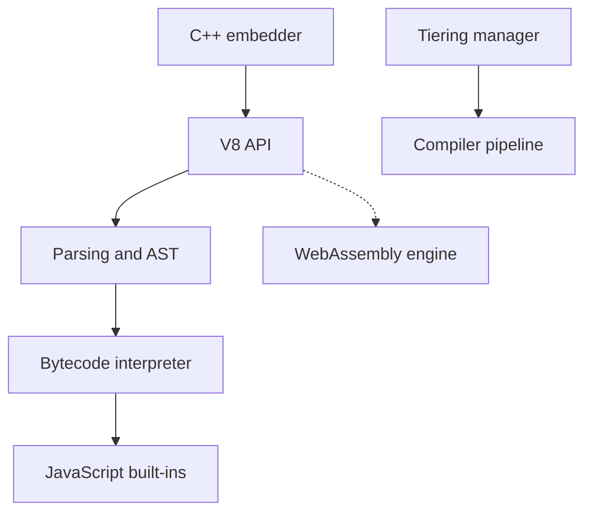

# v8/v8

> Moteur JavaScript et WebAssembly de Google, utilisé dans Chromium et intégrable dans une application C++.

## Le problème
Exécuter du JavaScript dans une application native demande un moteur capable de l'interpréter et de l'optimiser.

## Ce que ça fait vraiment
Implémente ECMAScript (ECMA-262), écrit en C++. S'utilise seul ou intégré via l'API publique. Analyse le code, l'exécute en bytecode, le compile avec plusieurs niveaux d'optimisation (baseline, Turboshaft) et gère la mémoire. Le support WebAssembly est visible dans le code.

## Comment c'est branché


## Essayer
```bash
fetch v8
git pull origin
gclient sync
```
Prérequis : depot_tools installé.

## Coût et pièges
Gratuit. La licence est présente mais non identifiée par GitHub. Récupération du code via depot_tools et construction longues, besoin réel en disque et mémoire (non détaillé dans le README). Les prérequis de compilation (toolchain C++) ne figurent pas dans la liste du plan.

## Ce que ce n'est pas
Pas un environnement d'exécution comme Node.js : c'est le moteur, sans système de fichiers ni réseau. Le README ne décrit presque rien de l'usage.

## Alternatives
Aucune alternative nommée dans le README.

## Pour toi
À ignorer : tu utilises V8 sans y toucher via Node.js ou Chrome ; l'intégrer directement n'a de sens que pour un projet de moteur.

