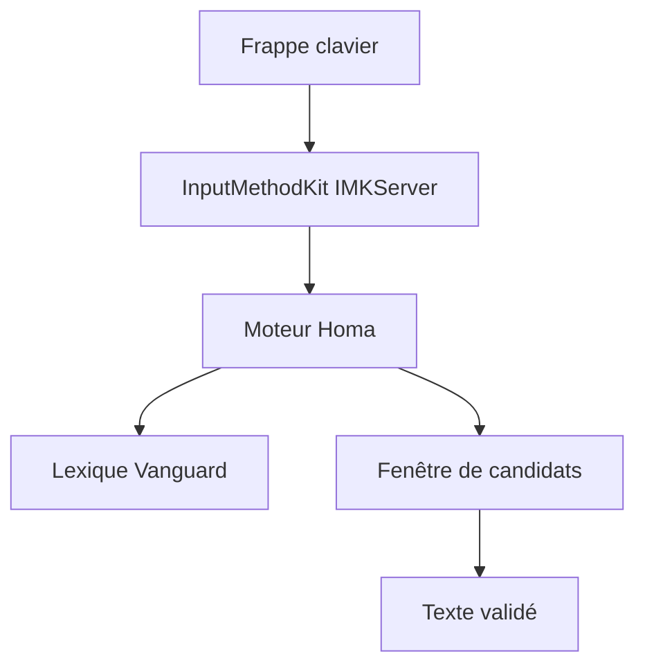

# vChewing/vChewing-macOS

> Zhuyin and pinyin Chinese input method for macOS, in traditional and simplified Chinese.

## The problem
Type Chinese on macOS with a flexible phrase engine and a high level of privacy.

## What it actually does
Native input method with many Zhuyin and pinyin layouts, Homa phrase engines and simultaneous input, an in-house lexicon, conversion to the new JIS Japanese characters. The macOS sandbox is enabled and the README claims that no data leaves the machine. Repository up to date on Gitee.

## How it is wired
Simplified diagram based on the sheet, no diagram provided.



## Trying it
```bash
make update
make release
make debug
```

## Cost and gotchas
Free. Building requires Swift 6.4 or later and a recent Xcode 27; Intel with Xcode 26 goes through SwiftPM. Swift is not in the prerequisites list. MulanPSL-2.0 license not identified by GitHub.

## What it is not
Not a cross-platform application nor a data tool.

## Alternatives
Rime, cited in the README under the name Squirrel (Rime/Squirrel, a competing input engine).

## For you
Ignore: input method for macOS, outside the data, AI or MLOps profile.
