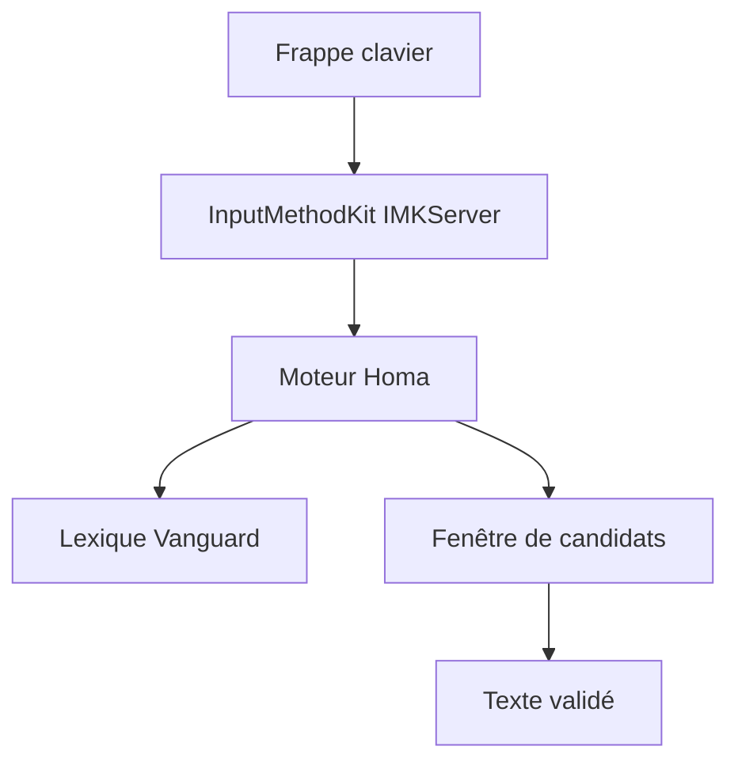

# vChewing/vChewing-macOS

> Méthode de saisie chinoise Zhuyin et pinyin pour macOS, en chinois traditionnel et simplifié.

## Le problème
Saisir du chinois sur macOS avec un moteur de phrases souple et un haut niveau de confidentialité.

## Ce que ça fait vraiment
Méthode de saisie native avec de nombreuses dispositions Zhuyin et pinyin, moteurs de phrases Homa et de saisie simultanée, lexique maison, conversion vers les nouveaux caractères japonais JIS. Le bac à sable macOS est activé et le README affirme qu'aucune donnée ne sort. Dépôt à jour sur Gitee.

## Comment c'est branché
Schéma simplifié d'après la fiche, sans diagramme fourni.



## Essayer
```bash
make update
make release
make debug
```

## Coût et pièges
Gratuit. Compiler exige Swift 6.4 ou plus et un Xcode 27 récent ; Intel avec Xcode 26 passe par SwiftPM. Swift n'existe pas dans la liste des prérequis. Licence MulanPSL-2.0 non identifiée par GitHub.

## Ce que ce n'est pas
Pas une application multiplateforme ni un outil data.

## Alternatives
Rime, citée dans le README sous le nom de Squirrel (Rime/Squirrel, moteur de saisie concurrent).

## Pour toi
À ignorer : méthode de saisie pour macOS, hors profil data, IA ou MLOps.

