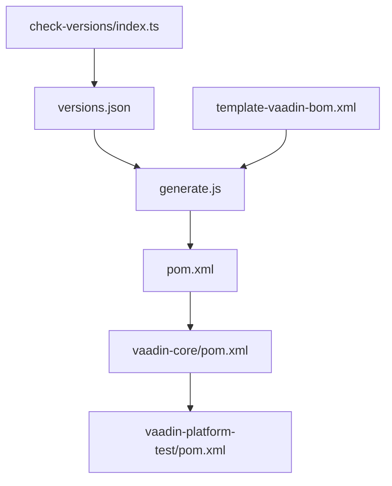

# vaadin/platform

> Repository that assembles the versions of Vaadin components into a single consistent package, for platform maintainers.

## The problem
Making dozens of Vaadin components work together requires a coordinated set of versions.

## What it actually does
The README is very short. According to the architecture, `versions.json` lists the versions, `generate.js` combines them with templates to produce the poms and Maven BOMs. TypeScript scripts check versions, update Spring Boot and drive releases.

## How it is wired

## Trying it
No command in the README: it refers to the "Building the Vaadin platform" documentation.

## Cost and gotchas
Not documented. License not declared by the catalog. Java and Maven are needed according to the architecture, but absent from the prerequisites list.

## What it is not
It is neither the framework itself nor a usage guide: it is the version packaging tooling.

## Alternatives
No alternative named in the README.

## For you
Ignore: internal release tooling for Java web developers, with no data or AI use.
