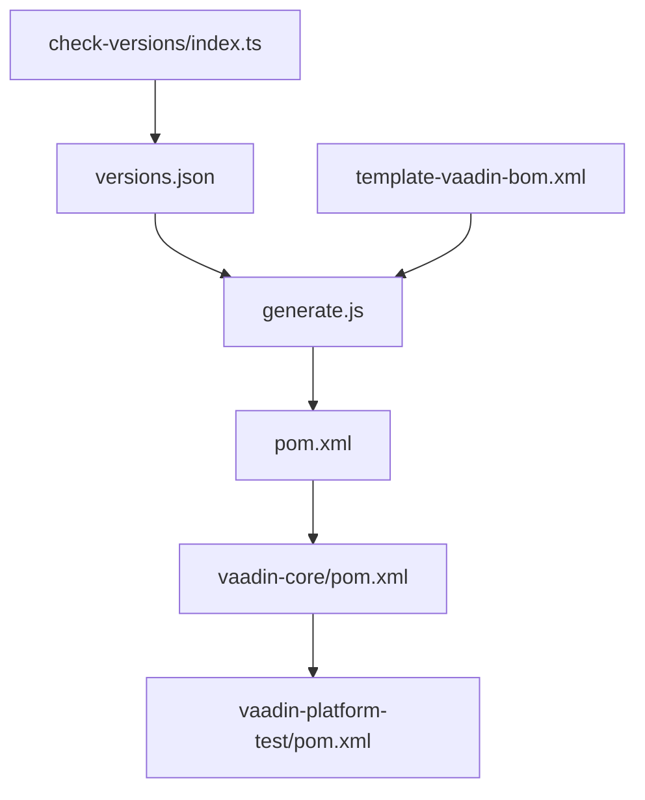

# vaadin/platform

> Dépôt qui assemble les versions des composants Vaadin en un seul paquet cohérent, pour mainteneurs de la plateforme.

## Le problème
Faire fonctionner ensemble des dizaines de composants Vaadin demande un jeu de versions coordonné.

## Ce que ça fait vraiment
Le README est très court. D'après l'architecture, `versions.json` liste les versions, `generate.js` les combine avec des gabarits pour produire les pom et les BOM Maven. Des scripts TypeScript vérifient les versions, mettent à jour Spring Boot et pilotent les releases.

## Comment c'est branché

## Essayer
Aucune commande dans le README : il renvoie à la documentation « Building the Vaadin platform ».

## Coût et pièges
Non documenté. Licence non déclarée par le catalogue. Java et Maven sont nécessaires d'après l'architecture, mais absents de la liste des prérequis.

## Ce que ce n'est pas
Ce n'est pas le framework lui-même ni un guide d'utilisation : c'est l'outillage de packaging des versions.

## Alternatives
Aucune alternative nommée dans le README.

## Pour toi
À ignorer : outillage interne de release pour développeurs web Java, sans usage data ou IA.

