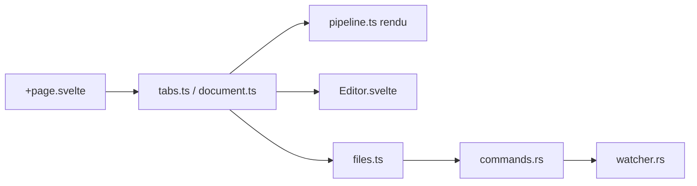

# vaibhav-kakde-in/mdhero

> Lightweight, local, telemetry-free native Markdown viewer and editor for macOS, Windows and Linux.

## The problem
Opening a `.md` in a code editor gives plain text; web viewers require uploading your files.

## What it actually does
Tauri v2 application (Rust + SvelteKit): markdown-it rendering with highlighting (highlight.js), KaTeX formulas, Mermaid diagrams, tabs, table of contents, search, vim keys, zen mode, PDF export via print. Light editing with `Cmd+E`/`Cmd+S`, automatic reload through file watching, opening by URL, pasting LLM output, discovery of `~/.claude/plans/`.

## How it is wired


## Trying it
```bash
pnpm install
pnpm tauri dev
pnpm tauri build
pnpm check
```
Otherwise download `.dmg`, `.msi`, `.deb`, `.rpm` or `.AppImage` from Releases.

## Cost and gotchas
Free. Node 22+, stable Rust and pnpm 10+ to build. Network is limited to the version check (can be disabled) and the URLs you enter. The announced macOS build is Apple Silicon.

## What it is not
Not a full editor like VS Code, nor a publishing tool. Editing is deliberately basic.

## Alternatives
No alternative cited in the README.

## For you
Worth watching: handy for reading agent plans and LLM exports locally, but young (created in April 2026) and replaceable by your current editor.
