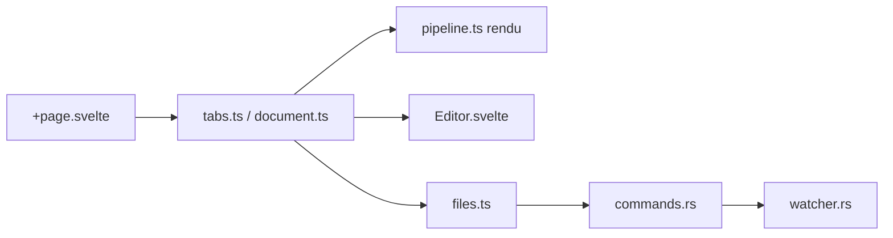

# vaibhav-kakde-in/mdhero

> Visionneuse et éditeur Markdown natif, léger, local et sans télémétrie, pour macOS, Windows et Linux.

## Le problème
Ouvrir un `.md` dans un éditeur de code donne du texte brut ; les visionneuses web exigent d'envoyer ses fichiers.

## Ce que ça fait vraiment
Application Tauri v2 (Rust + SvelteKit) : rendu markdown-it avec coloration (highlight.js), formules KaTeX, diagrammes Mermaid, onglets, table des matières, recherche, touches vim, mode zen, export PDF par impression. Édition légère avec `Cmd+E`/`Cmd+S`, rechargement automatique via surveillance de fichiers, ouverture par URL, collage de sortie LLM, découverte de `~/.claude/plans/`.

## Comment c'est branché


## Essayer
```bash
pnpm install
pnpm tauri dev
pnpm tauri build
pnpm check
```
Sinon télécharger `.dmg`, `.msi`, `.deb`, `.rpm` ou `.AppImage` depuis Releases.

## Coût et pièges
Gratuit. Node 22+, Rust stable et pnpm 10+ pour compiler. Réseau limité à la vérification de version (désactivable) et aux URLs que tu saisis. Le build macOS annoncé est Apple Silicon.

## Ce que ce n'est pas
Pas un éditeur complet type VS Code, ni un outil de publication. L'édition reste volontairement basique.

## Alternatives
Aucune alternative citée dans le README.

## Pour toi
À surveiller : pratique pour relire plans d'agents et exports LLM en local, mais jeune (créé en avril 2026) et remplaçable par ton éditeur actuel.

