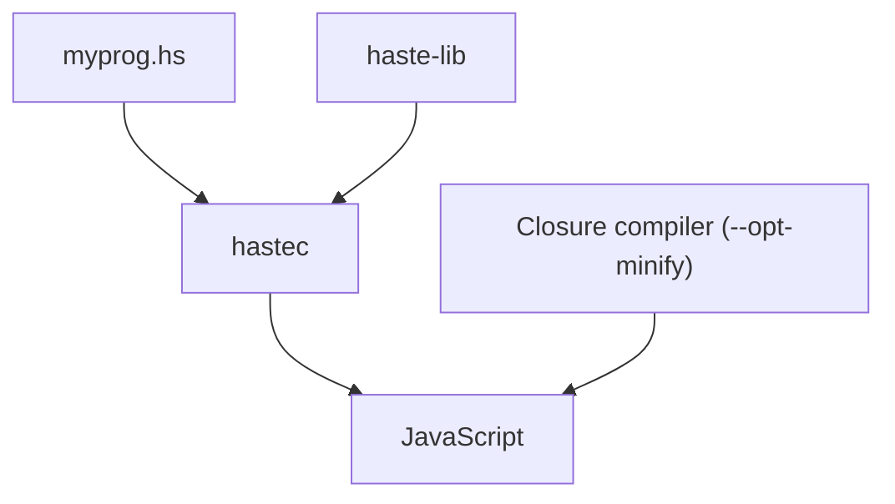

# valderman/haste-compiler

> Haskell-to-JavaScript compiler, for writing web applications in Haskell.

## The problem
Writing the web client and the server in two languages splits the logic and multiplies type errors.

## What it actually does
hastec compiles a Haskell program to JavaScript (equivalent to ghc --make). It offers Haste.Foreign to call JS, Haste.App for typed client-server over WebSockets, a small concurrency engine, DOM and canvas libraries. Template Haskell is not supported.

## How it is wired
Simplified diagram based on the sheet, no diagram provided.


## Trying it
```bash
cabal install haste-compiler
haste-boot
hastec myprog.hs
```

## Cost and gotchas
Free. Last push in March 2019: an abandoned project, running on old GHC versions. Some GHC primitives are missing and crash at runtime.

## What it is not
Not a current tool: compatibility with recent GHC versions is not documented.

## Alternatives
No alternative named in the README.

## For you
Ignore: abandoned since 2019 and unrelated to data/AI.
