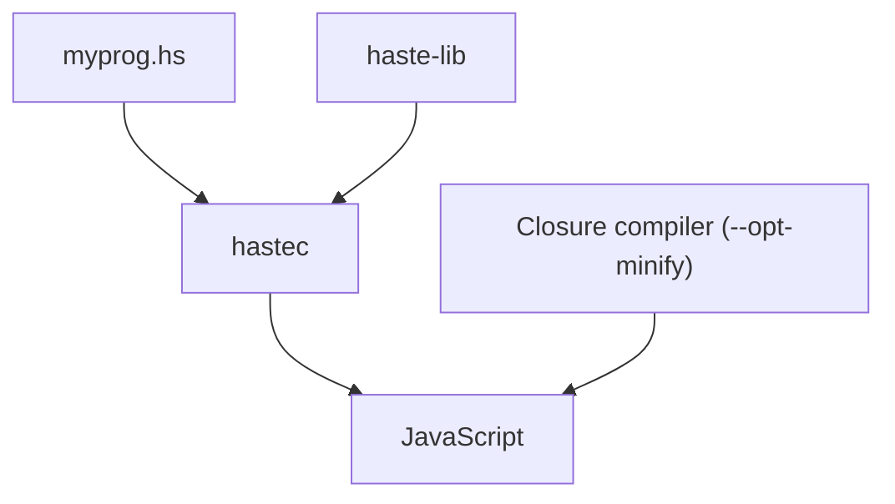

# valderman/haste-compiler

> Compilateur de Haskell vers JavaScript, pour écrire des applications web en Haskell.

## Le problème
Écrire le client web et le serveur dans deux langages sépare la logique et multiplie les erreurs de types.

## Ce que ça fait vraiment
hastec compile un programme Haskell en JavaScript (équivalent de ghc --make). Il propose Haste.Foreign pour appeler du JS, Haste.App pour le client-serveur typé via WebSockets, un petit moteur de concurrence, des bibliothèques DOM et canvas. Template Haskell n'est pas supporté.

## Comment c'est branché
Schéma simplifié d'après la fiche, sans diagramme fourni.


## Essayer
```bash
cabal install haste-compiler
haste-boot
hastec myprog.hs
```

## Coût et pièges
Gratuit. Dernier push en mars 2019 : projet délaissé, tournant sur d'anciens GHC. Des primitives GHC manquent et plantent à l'exécution.

## Ce que ce n'est pas
Pas un outil actuel : compatibilité avec les versions récentes de GHC non documentée.

## Alternatives
Aucune alternative nommée dans le README.

## Pour toi
Ignorer : abandonné depuis 2019 et sans lien avec data/IA.

