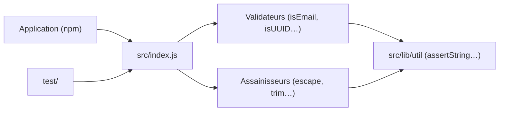

# validatorjs/validator.js

> JavaScript library of string validators and sanitizers, for server or browser.

## The problem
Validating emails, URLs, dates, identifiers or numbers by hand leads to fragile regular expressions.

## What it actually does
Dozens of `isXxx(str, options)` functions (email, URL, UUID, IBAN, credit card, date, JSON, JWT, strong password, phone by country…) and sanitizers (`escape`, `trim`, `normalizeEmail`, `toInt`…). It only handles strings: any other type causes an error. ES6 imports, CommonJS, or per-function imports for tree-shaking. The README specifies that `matches` is not protected against ReDoS attacks and that XSS sanitization was removed.

## How it is wired


## Trying it
```bash
npm i validator
```
```javascript
var validator = require('validator');
validator.isEmail('foo@bar.com'); //=> true
```

## Cost and gotchas
Free. Convert inputs to strings (`input + ''`). Do not let a user supply a pattern to `matches`.

## What it is not
It is not a schema or type validator, nor an XSS protection.

## Alternatives
For XSS, the README cites Yahoo's xss-filters and DOMPurify.

## For you
Watch: useful only in a Node service; in Python, a dedicated schema validator will be more suitable.
