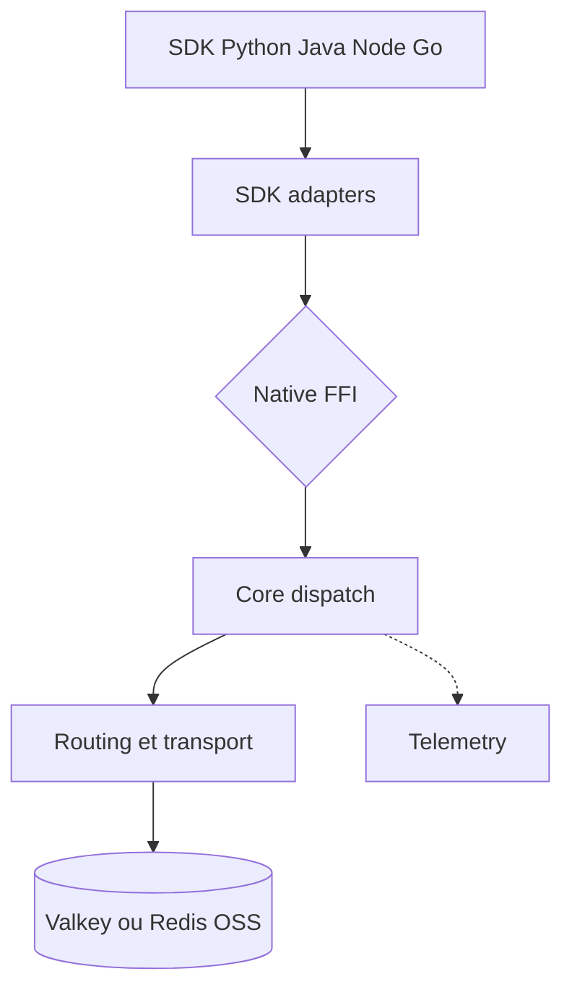

# valkey-io/valkey-glide

> Official multi-language client for Valkey and Redis OSS, with a shared Rust core.

## The problem
Each language has its own Redis client, with different cluster, reconnection and pub/sub behaviors.

## What it actually does
A Rust core handles connections, cluster routing, reconnection, pub/sub, cluster scan, batches (pipeline and transaction) and OpenTelemetry telemetry. Python, Java, Node, Go and PHP SDKs call it through FFI, JNI or N-API. It supports availability-zone affinity. Compression is experimental.

## How it is wired
Diagram taken from the code.

## Trying it
No command documented in the README: the documentation is at glide.valkey.io.

## Cost and gotchas
Free. A Valkey or Redis OSS server is required; zone affinity needs Valkey 8.0+ or ElastiCache for Valkey 7.2+. 585 open issues. Some SDKs are in preview or under development.

## What it is not
Not a Valkey server. Experimental compression is incompatible with several commands (INCR, APPEND, BITCOUNT...).

## Alternatives
- redis-py, Jedis, ioredis, go-redis, Lettuce, Redisson: migration guides exist from each of them.

## For you
Worth watching: a good candidate as a cache or feature store client on Valkey, but the lack of an install command and the uneven state of the SDKs mean you should check your language.
