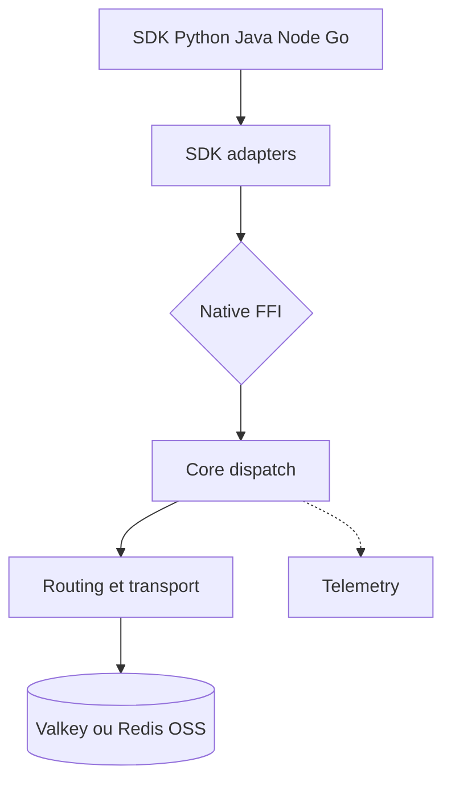

# valkey-io/valkey-glide

> Client officiel multilingue pour Valkey et Redis OSS, avec un cœur Rust partagé.

## Le problème
Chaque langage a son propre client Redis, avec des comportements de cluster, de reconnexion et de pub/sub différents.

## Ce que ça fait vraiment
Un cœur Rust gère connexions, routage de cluster, reconnexion, pub/sub, scan de cluster, lots (pipeline et transaction) et télémétrie OpenTelemetry. Des SDK Python, Java, Node, Go et PHP l'appellent par FFI, JNI ou N-API. Il prend en charge l'affinité de zone de disponibilité. La compression est expérimentale.

## Comment c'est branché
Schéma d'après le diagramme tiré du code.

## Essayer
Aucune commande documentée dans le README : la documentation est sur glide.valkey.io.

## Coût et pièges
Gratuit. Il faut un serveur Valkey ou Redis OSS ; l'affinité de zone exige Valkey 8.0+ ou ElastiCache for Valkey 7.2+. 585 issues ouvertes. Certains SDK sont en préversion ou en développement.

## Ce que ce n'est pas
Ce n'est pas un serveur Valkey. La compression expérimentale est incompatible avec plusieurs commandes (INCR, APPEND, BITCOUNT...).

## Alternatives
- redis-py, Jedis, ioredis, go-redis, Lettuce, Redisson : des guides de migration existent depuis chacun.

## Pour toi
À surveiller : un bon candidat comme client de cache ou de feature store sur Valkey, mais l'absence de commande d'installation et l'état variable des SDK demandent de vérifier ton langage.

