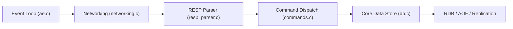

# valkey-io/valkey

> High-performance key-value data structure server, a Redis fork, under a BSD license.

## The problem
An in-memory cache or key-value database with an open license, after Redis's license change.

## What it actually does
A client sends a RESP command, the network layer parses it, the dispatcher checks permissions (ACL) then executes it on the native data structures, and the reply goes back. RDB and AOF persistence, replication, cluster, Sentinel, Lua scripts, modules, TLS and experimental RDMA. `redis-*` symbolic links ensure compatibility.

## How it is wired


## Trying it
```bash
make
make test
cd src
./valkey-server
./valkey-cli
```

## Cost and gotchas
Free. The CMake build is described as experimental, as is RDMA. You need to run distclean after changing dependencies or options. 941 open issues.

## What it is not
Not a relational database; data lives in memory, with optional persistence.

## Alternatives
Redis, of which it is the fork (cited by the README).

## For you
Adopt as a cache or feature queue in MLOps: drop-in compatible with Redis, BSD-3-Clause license.
