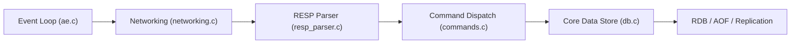

# valkey-io/valkey

> Serveur de structures de données clé-valeur haute performance, fork de Redis, sous licence BSD.

## Le problème
Un cache ou une base clé-valeur en mémoire, avec une licence ouverte, après le changement de licence de Redis.

## Ce que ça fait vraiment
Un client envoie une commande RESP, le réseau l'analyse, le répartiteur vérifie les droits (ACL) puis exécute sur les structures natives, et la réponse repart. Persistance RDB et AOF, réplication, cluster, Sentinel, scripts Lua, modules, TLS et RDMA expérimental. Des liens symboliques `redis-*` assurent la compatibilité.

## Comment c'est branché


## Essayer
```bash
make
make test
cd src
./valkey-server
./valkey-cli
```

## Coût et pièges
Gratuit. Le build CMake est dit expérimental, RDMA aussi. Il faut distclean après modification des dépendances ou options. 941 issues ouvertes.

## Ce que ce n'est pas
Pas une base de données relationnelle ; les données vivent en mémoire, avec persistance optionnelle.

## Alternatives
Redis, dont il est le fork (cité par le README).

## Pour toi
À adopter comme cache ou file de features en MLOps : drop-in compatible avec Redis, licence BSD-3-Clause.

