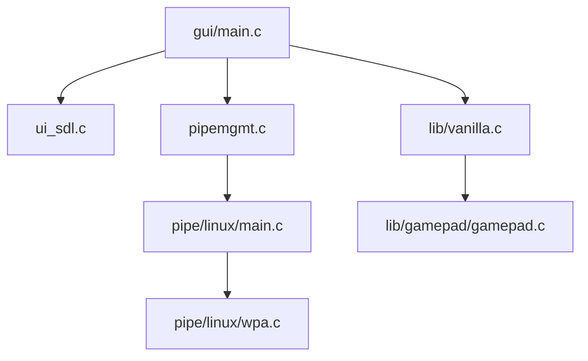

# vanilla-wiiu/vanilla

> Software clone of the Wii U gamepad, to play remotely from a PC or a console.

## The problem
Without the official gamepad, it is impossible to play a Wii U: the hardware is scarce.

## What it actually does
Vanilla imitates the Wii U gamepad: an SDL interface (gui/main.c) drives the lib/vanilla.c library, which handles video, audio and input. A process, pipe/linux/main.c, configures Wi-Fi through wpa.c. The author describes it as a work in progress, in alpha. A 5 GHz 802.11n Wi-Fi card is required.

## How it is wired


## Trying it
```bash
git clone https://github.com/vanilla-wiiu/vanilla.git
cd vanilla
mkdir build && cd build
cmake ..
cmake --build . --parallel
sudo cmake --install .
```

## Cost and gotchas
Free (GPL-2.0). You need a compatible Wi-Fi card and a Wii U; not all drivers work. The real requirements are CMake, SDL2, FFmpeg and NetworkManager.

## What it is not
It is not a Wii U game emulator: it only replaces the gamepad. It is not stable.

## Alternatives
No alternative named in the README.

## For you
Ignore: a console gamepad client is off-topic for data, AI or MLOps work.
