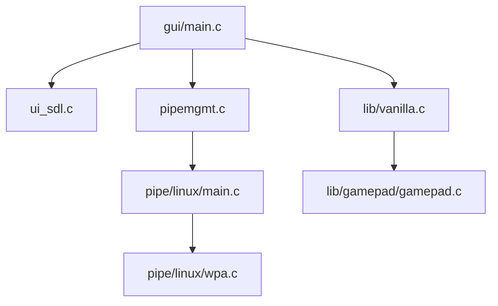

# vanilla-wiiu/vanilla

> Clone logiciel de la manette Wii U, pour jouer à distance depuis un PC ou une console.

## Le problème
Sans la manette officielle, impossible de jouer à une Wii U : le matériel est rare.

## Ce que ça fait vraiment
Vanilla imite la manette Wii U : une interface SDL (gui/main.c) pilote la bibliothèque lib/vanilla.c, qui gère la vidéo, l'audio et les entrées. Un processus pipe/linux/main.c configure le Wi-Fi via wpa.c. L'auteur le qualifie de travail en cours, en alpha. Une carte Wi-Fi 802.11n à 5 GHz est requise.

## Comment c'est branché


## Essayer
```bash
git clone https://github.com/vanilla-wiiu/vanilla.git
cd vanilla
mkdir build && cd build
cmake ..
cmake --build . --parallel
sudo cmake --install .
```

## Coût et pièges
Gratuit (GPL-2.0). Il faut une carte Wi-Fi compatible et une Wii U ; tous les pilotes ne fonctionnent pas. Le besoin réel est CMake, SDL2, FFmpeg et NetworkManager.

## Ce que ce n'est pas
Ce n'est pas un émulateur de jeux Wii U : il remplace seulement la manette. Ce n'est pas stable.

## Alternatives
Aucune alternative nommée dans le README.

## Pour toi
À ignorer : un client de manette de console est hors sujet pour un travail data, IA ou MLOps.

