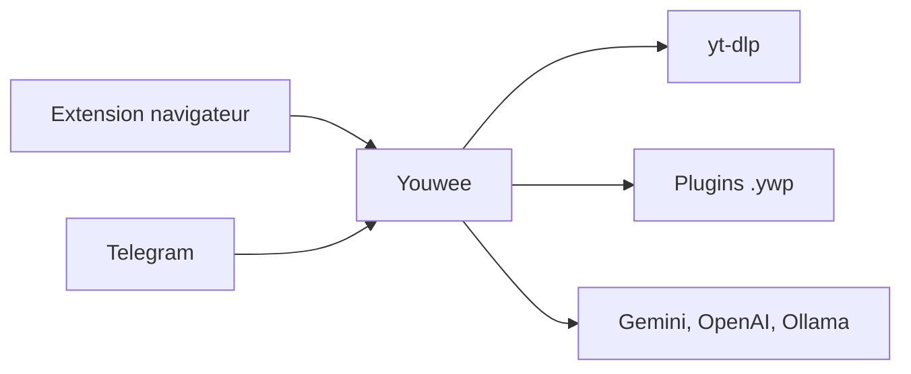

# vanloctech/youwee

> Desktop application for downloading and processing videos, a graphical interface around yt-dlp.

## The problem
yt-dlp on the command line is powerful but impractical for queues, followed channels and post-processing.

## What it actually does
Downloads videos from over 1800 sites, in batches or playlists, with audio extraction, subtitles and SponsorBlock. Adds channel tracking, a browser extension, Telegram control and signed plugins. A subtitle workshop and AI summaries or edits (Gemini, OpenAI or Ollama) complete the whole.

## How it is wired

Simplified diagram based on the sheet, no diagram provided.

## Trying it
```bash
git clone https://github.com/vanloctech/youwee.git
cd youwee
bun install
bun run tauri dev
```

## Cost and gotchas
Free; cloud AI features require your own keys. The macOS app is unsigned (`xattr -cr` required). Downloading may violate platform terms of service.

## What it is not
Not a data analysis tool. The README's legal warning reminds you that use remains your responsibility.

## Alternatives
No alternative named in the README, apart from yt-dlp which it wraps.

## For you
Worth watching: handy for fetching videos to transcribe, but the scope remains consumer-oriented and the project is recent.
