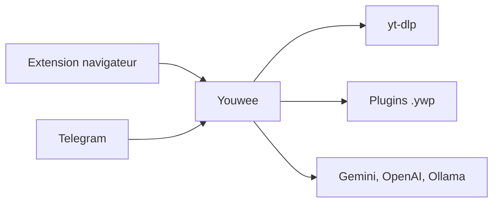

# vanloctech/youwee

> Application de bureau pour télécharger et traiter des vidéos, interface graphique autour de yt-dlp.

## Le problème
yt-dlp en ligne de commande est puissant mais peu pratique pour les files d'attente, les chaînes suivies et le post-traitement.

## Ce que ça fait vraiment
Télécharge des vidéos de plus de 1800 sites, par lot ou playlist, avec extraction audio, sous-titres et SponsorBlock. Ajoute un suivi de chaînes, une extension navigateur, un pilotage par Telegram et des plugins signés. Un atelier de sous-titres et des résumés ou montages par IA (Gemini, OpenAI ou Ollama) complètent l'ensemble.

## Comment c'est branché

Schéma simplifié d'après la fiche, sans diagramme fourni.

## Essayer
```bash
git clone https://github.com/vanloctech/youwee.git
cd youwee
bun install
bun run tauri dev
```

## Coût et pièges
Gratuit ; les fonctions IA cloud demandent tes propres clés. Application macOS non signée (`xattr -cr` requis). Le téléchargement peut enfreindre les conditions des plateformes.

## Ce que ce n'est pas
Pas un outil d'analyse de données. L'avertissement légal du README rappelle que l'usage reste de ta responsabilité.

## Alternatives
Aucune alternative nommée dans le README, hormis yt-dlp qu'il enveloppe.

## Pour toi
À surveiller : pratique pour récupérer des vidéos à transcrire, mais le périmètre reste grand public et le projet est récent.

