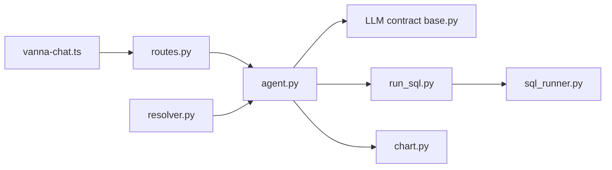

# vanna-ai/vanna

> Python framework for text-to-SQL agents that respect user permissions, with a web chat component.

## The problem
Letting business users query a database in natural language without exposing data beyond their rights is hard.

## What it actually does
`Agent` orchestrates the LLM, tools and streaming; `UserResolver` extracts the identity from your own auth.
Tools are permissioned by group (`RunSqlTool`, custom tools); SQL runners for SQLite, Postgres, Snowflake, BigQuery…
SSE streaming of rich components (tables, Plotly charts, summaries) to the `<vanna-chat>` component.
Lifecycle hooks, audit, observability; an adapter to migrate from Vanna 0.x.

## How it is wired

## Trying it
No installation command documented; only a FastAPI code example is provided.

## Cost and gotchas
LLM API key at your expense (or Ollama). Row-level filtering depends on your own implementation on the runner side.

## What it is not
Archived repository: no more fixes. "Row-level" security is not magic, it relies on your code.

## Alternatives
No alternative named in the README.

## For you
Keep an eye on it: a good reference architecture for permission-aware text-to-SQL, but archived — do not integrate it as a lasting dependency.
