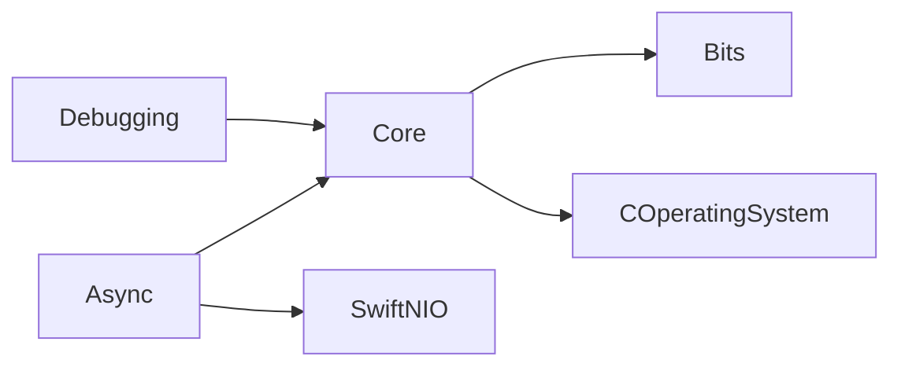

# vapor/core

> Former core Swift package for Vapor (async, bytes, system utilities), archived.

## The problem
Empty README: the sheet relies on the architecture deduced from the code.

## What it actually does
From the code: five Swift modules, `Async` (futures, workers, NIO bridge), `Bits` (byte extensions), `COperatingSystem` (libc wrapper), `Core` (files, processes, reflection, Base64/Hex coders) and `Debugging` (errors, `SourceLocation`).

## How it is wired

## Trying it
No documented command (empty README).

## Cost and gotchas
Free. Archived, last push in September 2021.

## What it is not
Not maintained, not documented here, not an application.

## Alternatives
None named in the README.

## For you
Ignore: archived since 2021 and specific to server-side Swift, so of no use to a data, AI or MLOps profile.
