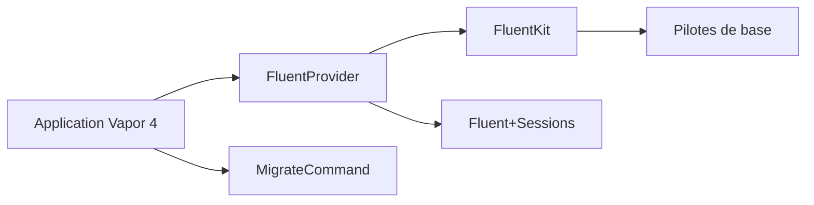

# vapor/fluent

> Bridge between the Vapor web framework (Swift) and the FluentKit database layer.

## The problem
Plugging the FluentKit ORM into the lifecycle of a Vapor application requires glue code.

## What it actually does
The README is two sentences long. The code shows a `FluentProvider`, a migration command, authentication helpers (`ModelAuthenticatable`, tokens, credentials), plus cache, history, pagination and sessions, with async/await wrappers.

## How it is wired

## Trying it
No command documented in the README; it points to the Fluent documentation.

## Cost and gotchas
Nothing quantified. Swift package to declare in `Package.swift`; a separate database driver is required (not documented here).

## What it is not
It is not the ORM itself (that is FluentKit) nor a database driver.

## Alternatives
No alternative named in the README.

## For you
Ignore: server-side Swift building block, unrelated to a data, AI or MLOps workflow, and an almost empty README.
