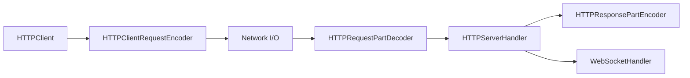

# vapor/http

> Former Swift HTTP and WebSocket client and server library on SwiftNIO, now archived.

## The problem
Empty README: this sheet rests on the architecture inferred from the code, with no text from the author.

## What it actually does
Based on the code: an "HTTPKit" module with `HTTPClient` and `HTTPServer` built as SwiftNIO handler chains (encoders, decoders, upgrade), shared `HTTPRequest`/`HTTPResponse`/`HTTPHeaders` models, and WebSocket support via upgrade.

## How it is wired

## Trying it
No documented command (empty README).

## Cost and gotchas
Free. Archived, last push in October 2021, 22 open issues: no support.

## What it is not
Not maintained, not documented, not a runnable application.

## Alternatives
None named in the README.

## For you
Ignore: archived since 2021, undocumented, and unrelated to data, AI or MLOps work.
