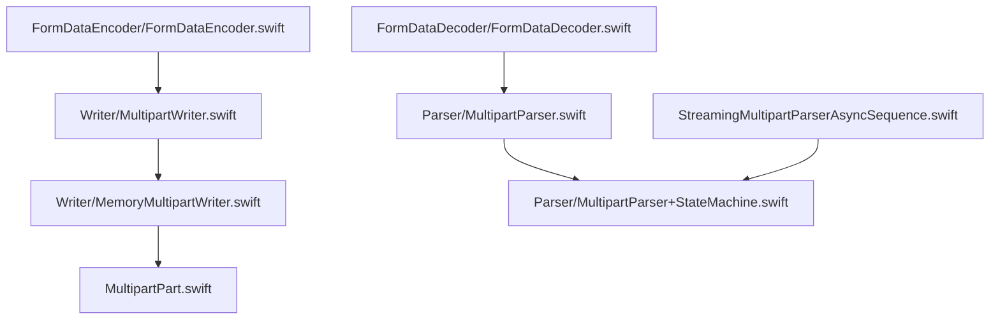

# vapor/multipart-kit

> Swift library to parse and produce multipart/form-data, with Codable support and async streams.

## The problem
Handling multipart file uploads without loading everything into memory is tedious.

## What it actually does
FormDataEncoder and FormDataDecoder handle Codable types, with bracket nesting. The encoder goes through writers, the decoder through a state-machine parser. Async sequences process large messages as streams.

## How it is wired


## Trying it
```swift
.package(url: "https://github.com/vapor/multipart-kit.git", from: "5.0.0-alpha.5"),
```

## Cost and gotchas
Version 5 is still alpha. Swift/SPM toolchain required. Null is not supported.

## What it is not
Not an HTTP client nor a server: only multipart encoding.

## Alternatives
No alternative named.

## For you
Ignore: Swift library for web servers, outside data/AI.
