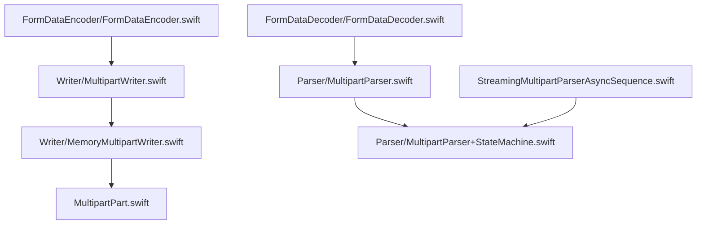

# vapor/multipart-kit

> Bibliothèque Swift pour analyser et produire du multipart/form-data, avec support Codable et flux asynchrones.

## Le problème
Traiter des envois de fichiers en multipart sans tout charger en mémoire est fastidieux.

## Ce que ça fait vraiment
FormDataEncoder et FormDataDecoder gèrent les types Codable, avec imbrication par crochets. L'encodeur passe par les writers, le décodeur par un parseur à machine d'états. Des séquences asynchrones traitent de gros messages en flux.

## Comment c'est branché


## Essayer
```swift
.package(url: "https://github.com/vapor/multipart-kit.git", from: "5.0.0-alpha.5"),
```

## Coût et pièges
Version 5 encore en alpha. Chaîne Swift/SPM requise. Le null n'est pas pris en charge.

## Ce que ce n'est pas
Pas un client HTTP ni un serveur : seulement l'encodage multipart.

## Alternatives
Aucune alternative nommée.

## Pour toi
À ignorer : bibliothèque Swift pour serveurs web, hors data/IA.

