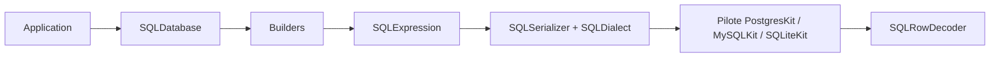

# vapor/sql-kit

> Swift library to build and serialize SQL queries, dialect-independent, for Swift/Vapor developers.

## The problem
Writing SQL by hand as strings is fragile and differs between Postgres, MySQL and SQLite.

## What it actually does
Provides fluent builders (`select`, `insert`, `update`, `delete`, `create table`) that produce a `SQLExpression` tree, serialized by `SQLSerializer` according to the `SQLDialect`. Values are bound as parameters. Does not handle connections: you need a driver (PostgresKit, MySQLKit, SQLiteKit) that implements `SQLDatabase`. Rows are decoded into `Codable`.

## How it is wired


## Trying it
```bash
# Package.swift
.package(url: "https://github.com/vapor/sql-kit.git", from: "3.0.0")
```

## Cost and gotchas
Free. Requires SwiftNIO 2.x and a separate database driver. For user input, use `\(bind:)` and not raw interpolation.

## What it is not
Neither an ORM nor a database driver. The README discourages `raw` queries in favor of the builders.

## Alternatives
- PostgresKit, MySQLKit, SQLiteKit: the drivers to add, not competitors.

## For you
Ignore: server-side Swift ecosystem tool, outside the Python/SQL stack of a data or MLOps profile.
