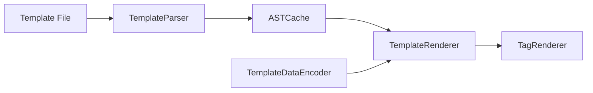

# vapor/template-kit

> Old Swift template rendering library (the basis of Leaf), archived.

## The problem
Empty README: the sheet relies on the architecture inferred from the code.

## What it actually does
Based on the code: `TemplateByteScanner` and `TemplateParser` produce an AST, `TemplateDataEncoder` converts Swift data into `TemplateData`, `TemplateRenderer` walks the AST and calls the `TagRenderer`s (Var, If, etc.), `ASTCache` keeps the parsed ASTs.

## How it is wired

## Trying it
No documented command (empty README).

## Cost and gotchas
Free. Archived, last push in March 2020.

## What it is not
Neither maintained nor documented here; not a general template engine outside Swift.

## Alternatives
None named in the README.

## For you
Ignore: archived since 2020, specific to server-side Swift, of no use for a data, AI or MLOps profile.
