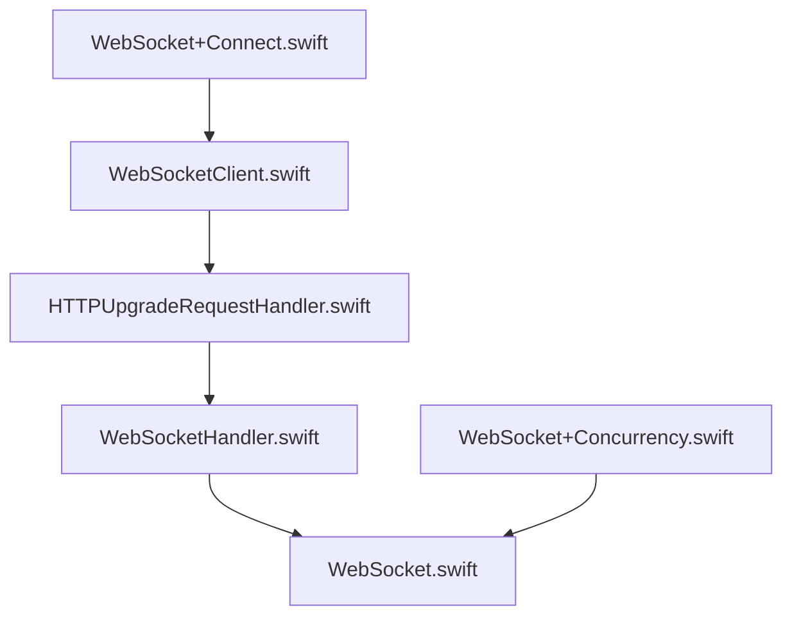

# vapor/websocket-kit

> Swift layer over SwiftNIO for writing WebSocket clients and servers more simply.

## The problem
Using SwiftNIO's WebSockets directly is low-level.

## What it actually does
It provides sending and receiving of data, ping/pong, text, connection handling and protocol upgrade. From the code: `WebSocket+Connect.swift` starts the connection, `WebSocketClient` and the HTTP upgrade request come before `WebSocketHandler`, which produces the `WebSocket` object. Concurrency extensions add the async variants.

## How it is wired

## Trying it
No command documented in the README.

## Cost and gotchas
Requires Swift and SwiftNIO (not detailed). Very short README: little information.

## What it is not
Not a web framework: it handles neither routing nor the application. It targets Swift only.

## Alternatives
No alternative named in the README.

## For you
Ignore: Swift library with no link to data/AI/MLOps.
