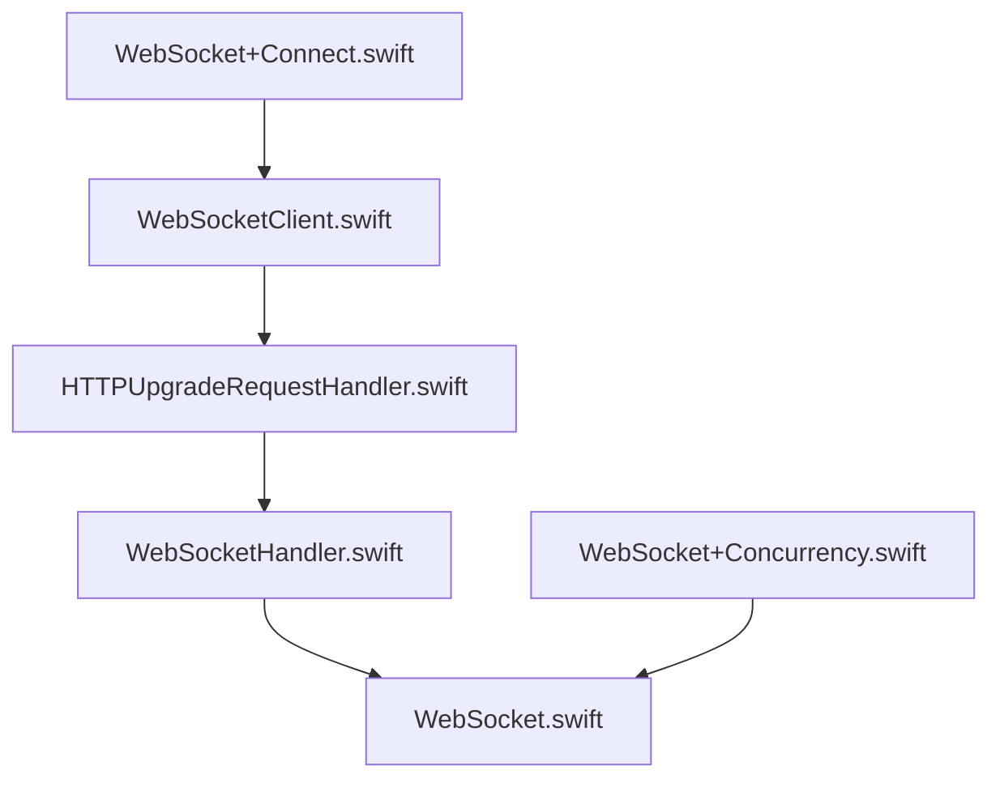

# vapor/websocket-kit

> Surcouche Swift à SwiftNIO pour écrire des clients et serveurs WebSocket plus simplement.

## Le problème
Utiliser les WebSockets de SwiftNIO directement est bas niveau.

## Ce que ça fait vraiment
Il fournit l'envoi et la réception de données, les ping/pong, le texte, la gestion de connexion et de la montée de protocole (upgrade). D'après le code : `WebSocket+Connect.swift` démarre la connexion, `WebSocketClient` et la requête d'upgrade HTTP précèdent `WebSocketHandler`, qui produit l'objet `WebSocket`. Des extensions de concurrence ajoutent les variantes async.

## Comment c'est branché

## Essayer
Aucune commande documentée dans le README.

## Coût et pièges
Nécessite Swift et SwiftNIO (non détaillé). README très court : peu d'information.

## Ce que ce n'est pas
Pas un framework web : il ne gère ni routage ni application. Il vise Swift uniquement.

## Alternatives
Aucune alternative nommée dans le README.

## Pour toi
Ignorer : bibliothèque Swift sans lien avec data/IA/MLOps.

