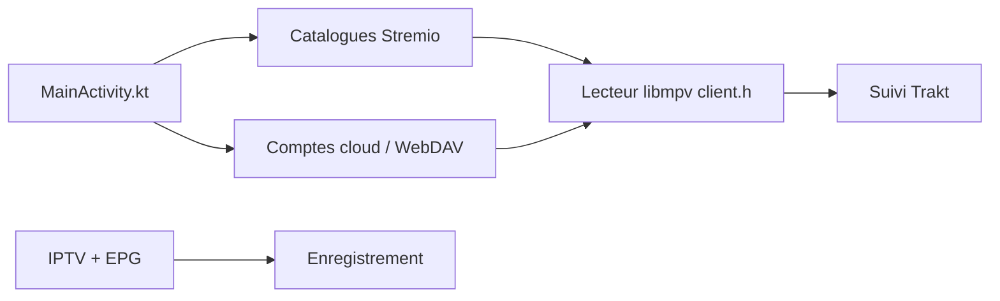

# varunsalian/debrify

> Cross-platform Flutter application that brings cloud accounts, WebDAV, IPTV and Stremio catalogs together in a single player.

## The problem
Media, debrid subscriptions and IPTV lists are scattered across several applications with as many players.

## What it actually does
A native player (media_kit/libmpv) with subtitles, playback resume and a remote-control interface for TV. It connects to Real-Debrid, Torbox, Premiumize, PikPak, AllDebrid, WebDAV, YouTube, Stremio catalogs and IPTV (M3U, Xtream, EPG, recording). Download manager, Trakt, Simkl and MDBList tracking. Android, Android TV, iOS, macOS, Windows, Linux.

## How it is wired


## Trying it
```bash
git clone https://github.com/varunsalian/debrify.git
cd debrify
flutter pub get
flutter run
```

## Cost and gotchas
The app is free, but you pay for the debrid services. iOS installation by sideload (re-signing every 7 days), macOS not notarized.

## What it is not
Not a content host: it provides none. The README admits to untidy code (huge files, static state).

## Alternatives
The README cites Stremio, whose addons it reads, without proposing an alternative.

## For you
Ignore: entertainment tool outside the data/AI profile, from a single person, under AGPL and with acknowledged code debt.
