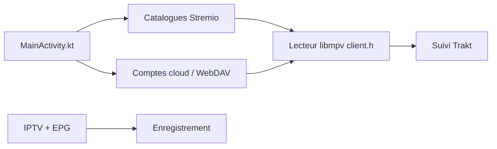

# varunsalian/debrify

> Application Flutter multiplateforme qui réunit comptes cloud, WebDAV, IPTV et catalogues Stremio dans un seul lecteur.

## Le problème
Médias, abonnements de débridage et listes IPTV sont éparpillés dans plusieurs applications avec autant de lecteurs.

## Ce que ça fait vraiment
Un lecteur natif (media_kit/libmpv) avec sous-titres, reprise de lecture et interface télécommande pour TV. Il se branche sur Real-Debrid, Torbox, Premiumize, PikPak, AllDebrid, WebDAV, YouTube, catalogues Stremio et IPTV (M3U, Xtream, EPG, enregistrement). Gestionnaire de téléchargements, suivi Trakt, Simkl et MDBList. Android, Android TV, iOS, macOS, Windows, Linux.

## Comment c'est branché


## Essayer
```bash
git clone https://github.com/varunsalian/debrify.git
cd debrify
flutter pub get
flutter run
```

## Coût et pièges
L'app est gratuite, mais tu paies les services de débridage. Installation iOS par sideload (re-signature tous les 7 jours), macOS non notarisé.

## Ce que ce n'est pas
Pas un hébergeur de contenu : il n'en fournit aucun. Le README avoue un code peu propre (fichiers énormes, état statique).

## Alternatives
Le README cite Stremio dont il lit les addons, sans proposer d'alternative.

## Pour toi
À ignorer : outil de divertissement hors profil data/IA, d'une personne, sous AGPL et avec une dette de code assumée.

