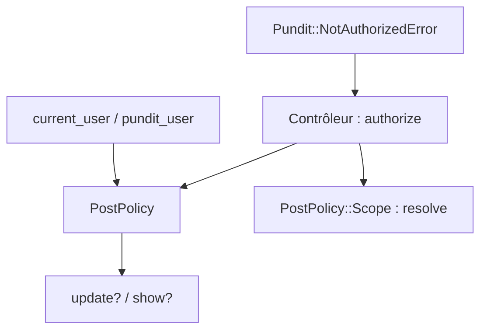

# varvet/pundit

> Ruby authorization gem based on simple policy classes, for Rails applications.

## The problem
Deciding who can do what on which resource quickly gets scattered across an application's controllers and views.

## What it actually does
One policy class per model (`PostPolicy`) with methods like `update?`. In the controller, `authorize` instantiates the policy with `current_user` and the object, then calls the method tied to the action. Scopes filter lists. `verify_authorized` helps catch an omission. An RSpec matcher is included.

## How it is wired
Simplified diagram based on the sheet, no diagram provided.



## Trying it
```bash
bundle add pundit
rails g pundit:install
rails g pundit:policy post
```

## Cost and gotchas
Free (MIT), but Ruby on Rails is required (missing from the prerequisites list). The README states that the omission check is only a development aid, not a protection. Pundit caches the user: call `pundit_reset!` after a change.

## What it is not
It is not an authentication system. It deliberately refuses extra arguments passed to policies.

## Alternatives
No alternative named in the README (an external resource covers migration from CanCan).

## For you
Ignore: Ruby on Rails tool, outside your data / AI / MLOps scope.
