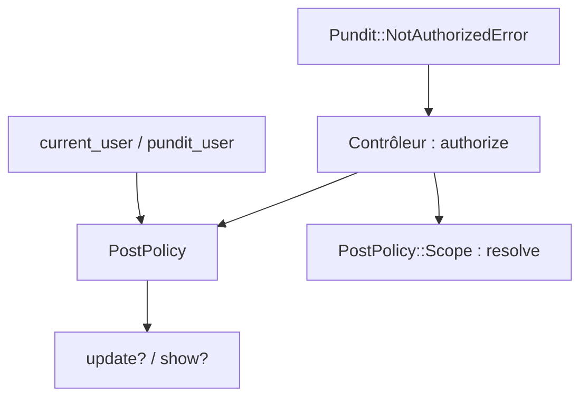

# varvet/pundit

> Gem Ruby d'autorisation par classes de politiques simples, pour applications Rails.

## Le problème
Décider qui peut faire quoi sur quelle ressource se disperse vite dans les contrôleurs et les vues d'une application.

## Ce que ça fait vraiment
Une classe de politique par modèle (`PostPolicy`) avec des méthodes comme `update?`. Dans le contrôleur, `authorize` instancie la politique avec `current_user` et l'objet, puis appelle la méthode liée à l'action. Les « scopes » filtrent les listes. `verify_authorized` aide à repérer un oubli. Un matcher RSpec est inclus.

## Comment c'est branché
Schéma simplifié d'après la fiche, sans diagramme fourni.



## Essayer
```bash
bundle add pundit
rails g pundit:install
rails g pundit:policy post
```

## Coût et pièges
Gratuit (MIT), mais Ruby on Rails requis (absent de la liste des prérequis). Le README précise que la vérification d'oubli n'est qu'une aide au développement, pas une protection. Pundit met en cache l'utilisateur : appeler `pundit_reset!` après un changement.

## Ce que ce n'est pas
Ce n'est pas un système d'authentification. Il refuse volontairement les arguments supplémentaires passés aux politiques.

## Alternatives
Aucune alternative nommée dans le README (une ressource externe parle de migration depuis CanCan).

## Pour toi
À ignorer : outil Ruby on Rails, hors de ton périmètre data / IA / MLOps.

