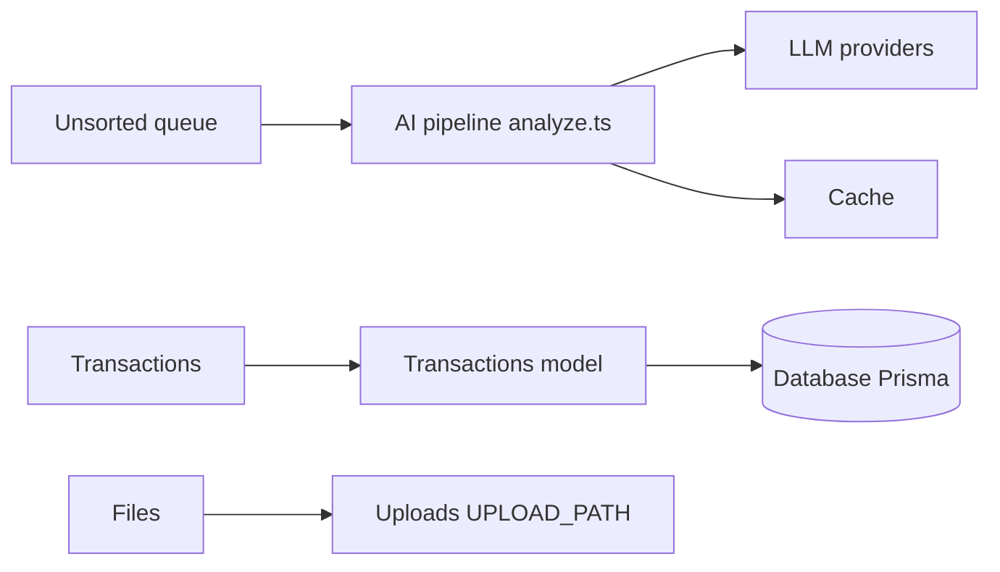

# vas3k/TaxHacker

> Self-hosted accounting application that uses AI to extract data from receipts and invoices for freelancers.

## The problem
Manually entering the dates, amounts, merchants and taxes of every receipt takes time for freelancers and small businesses.

## What it actually does
You drop in photos or PDFs; an LLM (OpenAI, Gemini, Mistral or an OpenAI-compatible local model) extracts the fields, categorizes them and stores them in a PostgreSQL database. Fields, categories, projects and prompts are customizable. Currency conversion at the transaction date, full-text search, CSV import, export with attachments, backups. Next.js application with Prisma.

## How it is wired


## Trying it
```bash
curl -O https://raw.githubusercontent.com/vas3k/TaxHacker/main/docker-compose.yml
docker compose up
```
The application is then available on port 7331.

## Cost and gotchas
Free to host, but LLM calls (OpenAI, Gemini, Mistral) are billed to your key. A local model must be good at OCR, with no guarantee. Your financial documents pass through the chosen provider.

## What it is not
Not certified tax software: the README says "early development, use at your own risk". The code also contains a cloud part with Stripe, absent from the self-hosted mode.

## Alternatives
No alternative named in the README.

## For you
Watch: a concrete example of LLM document extraction with editable prompts, but young and to be tested on non-sensitive data.
