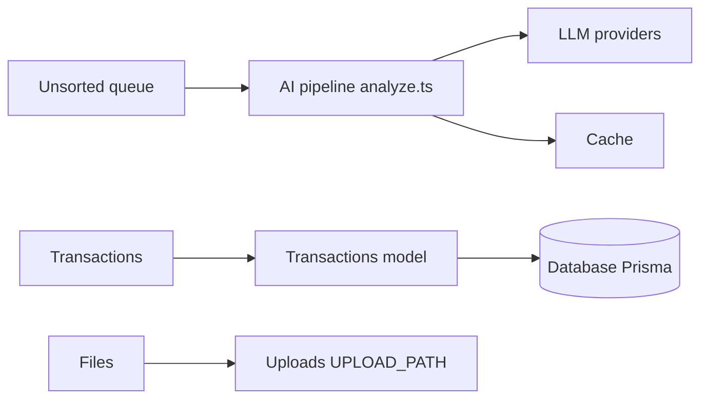

# vas3k/TaxHacker

> Application de comptabilité auto-hébergée qui extrait par IA les données de reçus et factures pour indépendants.

## Le problème
Saisir à la main dates, montants, marchands et taxes de chaque reçu prend du temps aux indépendants et petites structures.

## Ce que ça fait vraiment
Tu déposes photos ou PDF ; un LLM (OpenAI, Gemini, Mistral ou un modèle local compatible OpenAI) extrait les champs, catégorise et range en base PostgreSQL. Champs, catégories, projets et prompts sont personnalisables. Conversion de devises à la date de la transaction, recherche plein texte, import CSV, export avec pièces jointes, sauvegardes. Application Next.js avec Prisma.

## Comment c'est branché


## Essayer
```bash
curl -O https://raw.githubusercontent.com/vas3k/TaxHacker/main/docker-compose.yml
docker compose up
```
Application ensuite sur le port 7331.

## Coût et pièges
Gratuit à héberger, mais les appels LLM (OpenAI, Gemini, Mistral) sont facturés selon ta clé. Un modèle local doit être bon en OCR, sans garantie. Tes documents financiers transitent chez le fournisseur choisi.

## Ce que ce n'est pas
Pas un logiciel fiscal certifié : le README dit « early development, use at your own risk ». Le code contient aussi un volet cloud avec Stripe, absent du mode auto-hébergé.

## Alternatives
Aucune alternative nommée dans le README.

## Pour toi
À surveiller : exemple concret d'extraction de documents par LLM avec prompts modifiables, mais jeune et à tester sur des données non sensibles.

