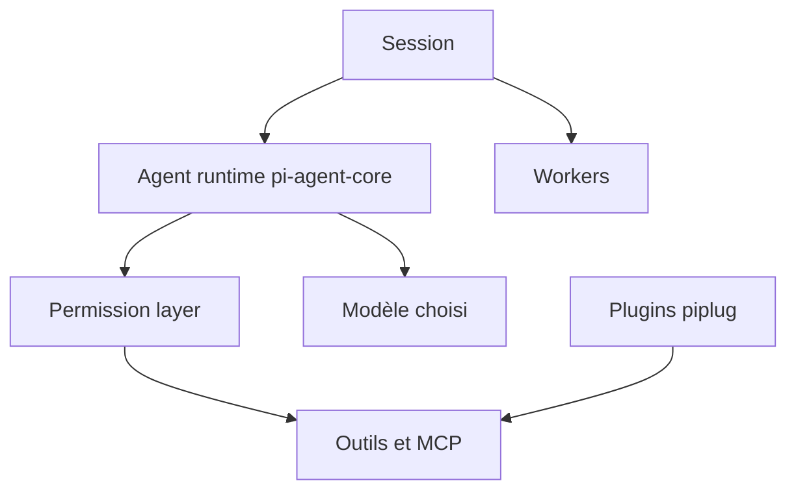

# vastsa/PI-Desktop

> Modular desktop workspace for AI agents, with plugins, sessions and orchestration.

## The problem
Agents in the terminal or the IDE offer no persistent space for projects, sessions and reviews.

## What it actually does
Desktop application organized as project, session, agent. Three modes: Agent, Plan, Goal. Sub-agents and worker sessions work in parallel. Models are interchangeable (OpenAI, Anthropic, compatible APIs, Ollama, LM Studio). `.piplug` plugins add panels, tools, MCP servers and services. Import of Claude Code, Codex, OpenCode and Pi sessions.

## How it is wired


## Trying it
```bash
git clone https://github.com/vastsa/PI-Desktop.git
cd PI-Desktop
pnpm install
cargo build -p host-core
pnpm build:js
pnpm dev
```

## Cost and gotchas
Free, but requests go to your model provider, so an API key or a local model is needed. Source build: Node 22.19+, pnpm 10+, stable Rust. No telemetry announced.

## What it is not
Version 0.21.x in early preview. It is not a model: it relies on the pi ecosystem for the agent engine.

## Alternatives
No alternative named in the README (Claude Code, Codex, OpenCode serve for import).

## For you
Worth watching: interesting for driving several agents, but early preview and a single maintainer.
