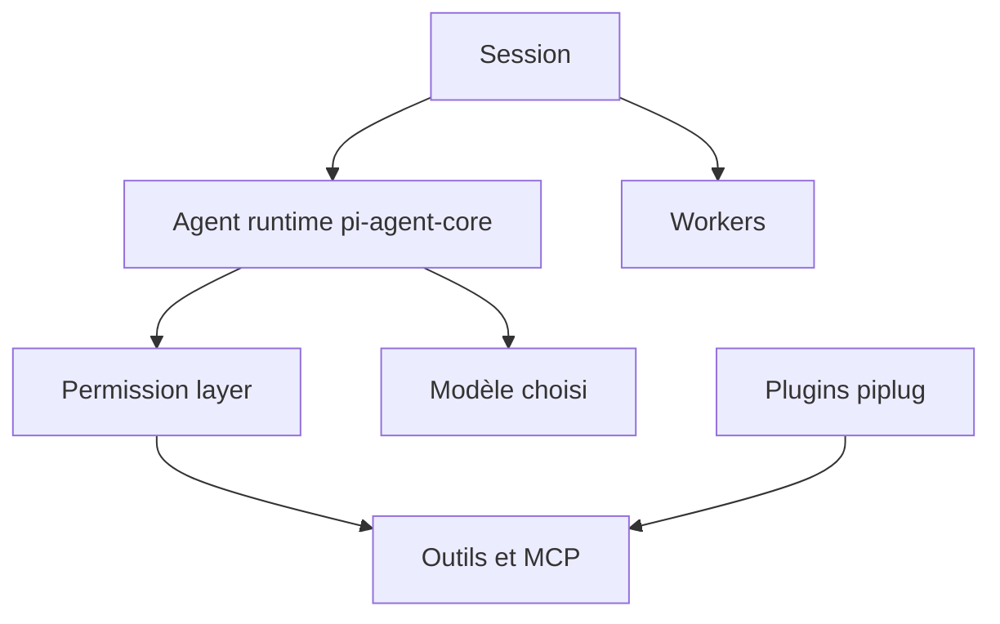

# vastsa/PI-Desktop

> Espace de travail de bureau modulaire pour agents IA, avec plugins, sessions et orchestration.

## Le problème
Les agents en terminal ou dans l'IDE n'offrent pas d'espace persistant pour projets, sessions et revues.

## Ce que ça fait vraiment
Application de bureau organisée en projet, session, agent. Trois modes : Agent, Plan, Goal. Des sous-agents et des sessions workers travaillent en parallèle. Les modèles sont interchangeables (OpenAI, Anthropic, API compatibles, Ollama, LM Studio). Les plugins `.piplug` ajoutent panneaux, outils, serveurs MCP et services. Import de sessions Claude Code, Codex, OpenCode et Pi.

## Comment c'est branché


## Essayer
```bash
git clone https://github.com/vastsa/PI-Desktop.git
cd PI-Desktop
pnpm install
cargo build -p host-core
pnpm build:js
pnpm dev
```

## Coût et pièges
Gratuit, mais les requêtes vont à ton fournisseur de modèle, donc clé d'API ou modèle local. Source : Node 22.19+, pnpm 10+, Rust stable. Aucune télémétrie annoncée.

## Ce que ce n'est pas
Version 0.21.x en aperçu précoce. Ce n'est pas un modèle : il s'appuie sur l'écosystème pi pour le moteur d'agent.

## Alternatives
Aucune alternative nommée dans le README (Claude Code, Codex, OpenCode servent à l'import).

## Pour toi
À surveiller : intéressant pour piloter plusieurs agents, mais aperçu précoce et mainteneur unique.

