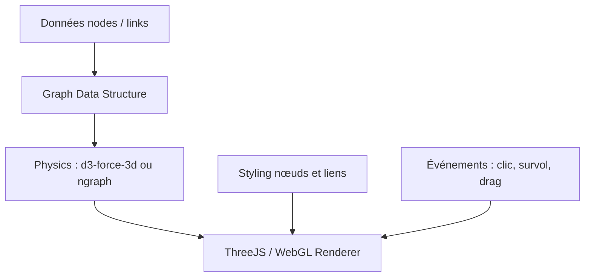

# vasturiano/3d-force-graph

> Web component that displays a 3D graph with a force-directed layout, for anyone visualizing networks.

## The problem
A graph of thousands of nodes is unreadable in static 2D; an explorable view is needed.

## What it actually does
JavaScript component that draws nodes and links with ThreeJS and WebGL. The physics relies on d3-force-3d or ngraph. The data is a `{ nodes, links }` object. The API covers styling, particles and arrows on links, clicks and hovers, DAG mode and the camera.

## How it is wired


## Trying it
```bash
# ES module
import ForceGraph3D from '3d-force-graph';
# ou balise script
<script src="//cdn.jsdelivr.net/npm/3d-force-graph"></script>
# puis
const myGraph = new ForceGraph3D(<myDOMElement>).graphData(<myData>);
```

## Cost and gotchas
Free. A browser with WebGL is required. Node drag-and-drop only works with the d3 engine. `enablePointerInteraction` costs performance on large graphs.

## What it is not
Not a graph analysis tool: it only displays what it is given. DAG mode requires a graph without cycles.

## Alternatives
The 2D, VR and AR versions by the same author, and the React bindings, cited in the README.

## For you
To watch: handy for showing a knowledge or dependency graph in a demo, with no value for model training or deployment.
