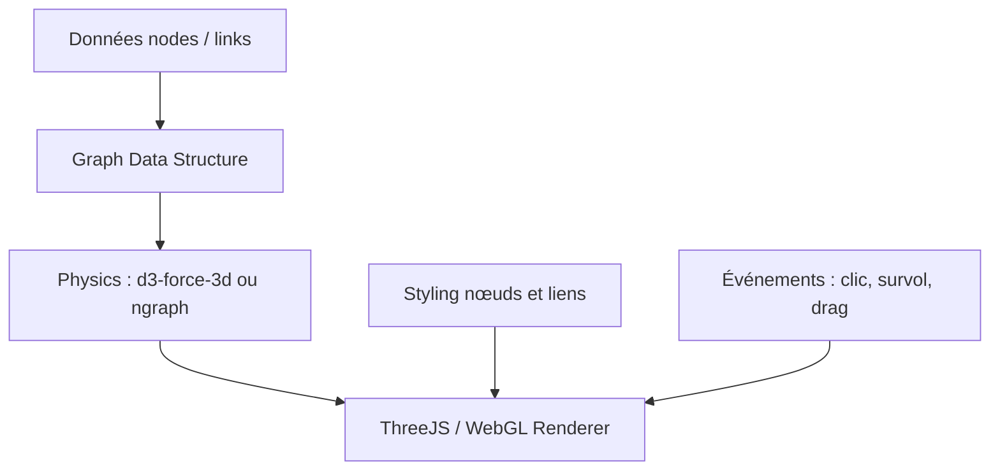

# vasturiano/3d-force-graph

> Composant web qui affiche un graphe en 3D avec une mise en page par forces, pour qui visualise des réseaux.

## Le problème
Un graphe de milliers de nœuds est illisible en 2D statique ; il faut une vue explorable.

## Ce que ça fait vraiment
Composant JavaScript qui dessine nœuds et liens avec ThreeJS et WebGL. La physique repose sur d3-force-3d ou ngraph. Les données sont un objet `{ nodes, links }`. L'API couvre le style, les particules et flèches sur les liens, les clics et survols, le mode DAG et la caméra.

## Comment c'est branché


## Essayer
```bash
# ES module
import ForceGraph3D from '3d-force-graph';
# ou balise script
<script src="//cdn.jsdelivr.net/npm/3d-force-graph"></script>
# puis
const myGraph = new ForceGraph3D(<myDOMElement>).graphData(<myData>);
```

## Coût et pièges
Gratuit. Il faut un navigateur avec WebGL. Le glisser-déposer de nœuds ne marche qu'avec le moteur d3. `enablePointerInteraction` coûte en performances sur les gros graphes.

## Ce que ce n'est pas
Ce n'est pas un outil d'analyse de graphes : il n'affiche que ce qu'on lui donne. Le mode DAG exige un graphe sans cycle.

## Alternatives
Les versions 2D, VR et AR du même auteur, et les liaisons React, citées dans le README.

## Pour toi
À surveiller : pratique pour montrer un graphe de connaissances ou de dépendances en démonstration, sans valeur pour l'entraînement ou le déploiement de modèles.

