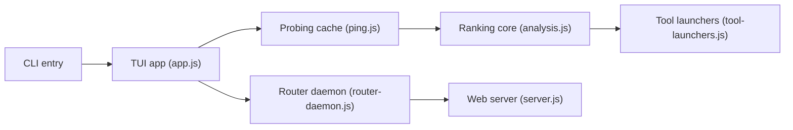

# vava-nessa/free-coding-models

> Terminal dashboard that ranks free coding models live and plugs them into your tool.

## The problem
There are many free models across many providers; which one is fast and stable right now?

## What it actually does
Probes 256 models from 24 providers in parallel, computes a stability score (p95, jitter, spikes, availability) and a tier based on SWE-bench Verified. One Enter writes the chosen model into the config of OpenCode, Goose, Aider, etc. A local OpenAI-compatible daemon (port 19280) does automatic failover.

## How it is wired


## Trying it
```bash
npm install -g free-coding-models
free-coding-models --help
free-coding-models --daemon-bg
```

## Cost and gotchas
Free, but you need an account and a key with at least one provider (Groq, Cerebras, NVIDIA NIM). Probes consume quota. Anonymous telemetry is on by default (`--no-telemetry`).

## What it is not
It is not a model nor a host. "Free" applies to a provider/model pair and may change. License not identified by GitHub (the README claims MIT).

## Alternatives
No alternative named in the README.

## For you
Worth watching: handy for choosing a free model to plug into a coding agent, but depends on unstable provider quotas.
