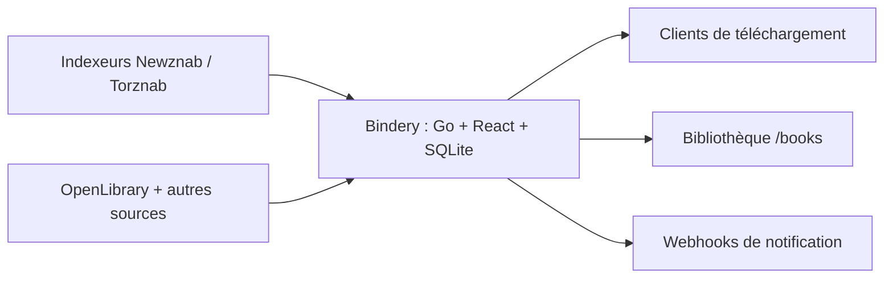

# vavallee/bindery

> Self-hosted Usenet/torrent ebook and audiobook manager, designed to replace Readarr.

## The problem
Readarr has been archived since June 2025 (metadata backend gone) and the forks depend on fragile Goodreads scrapers.

## What it actually does
Monitors authors, queries Newznab/Torznab indexers, sends to download clients (SABnzbd, NZBGet, qBittorrent, Transmission, Deluge, rTorrent), then imports and renames. Metadata comes from several public APIs (OpenLibrary first, Google Books, Hardcover, DNB, Audnex, Audible). Imports a `readarr.db` database, offers OPDS, multi-user, OIDC, Calibre and Audiobookshelf integration.

## How it is wired


## Trying it
```bash
docker run -d --name bindery -p 8787:8787 \
  -v /path/to/config:/config -v /path/to/books:/books \
  -v /path/to/downloads:/downloads ghcr.io/vavallee/bindery:latest
bindery migrate readarr /path/to/readarr.db
```

## Cost and gotchas
Free, but you need indexers and a download client (often paid). Daily anonymous ping to api.getbindery.dev (can be disabled). 108 open issues. The legality of what you download is your responsibility.

## What it is not
Not a reader nor a library server: the README points to Calibre-Web and Audiobookshelf. It ships no indexer.

## Alternatives
- LazyLibrarian: established tool, with magazines and comics, more dated interface.
- Livrarr: same "single binary" spirit, but in alpha.
- Calibre-Web / Audiobookshelf: serve an already built library.

## For you
Ignore: a home media manager unrelated to data, AI or MLOps work; useful only if you run a book library.
