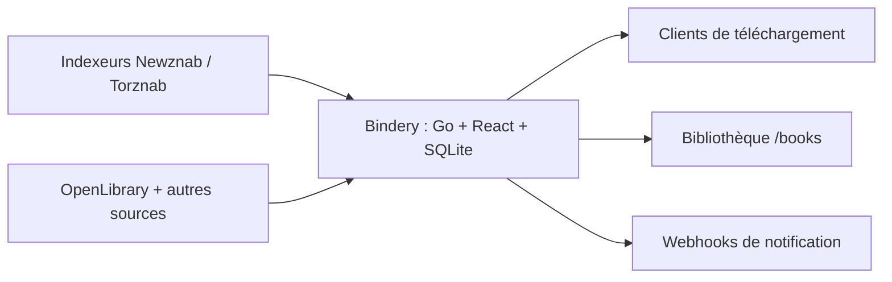

# vavallee/bindery

> Gestionnaire auto-hébergé d'ebooks et d'audiolivres Usenet/torrent, pensé pour remplacer Readarr.

## Le problème
Readarr est archivé depuis juin 2025 (backend de métadonnées disparu) et les forks dépendent de scrapers Goodreads fragiles.

## Ce que ça fait vraiment
Surveille des auteurs, interroge des indexeurs Newznab/Torznab, envoie aux clients de téléchargement (SABnzbd, NZBGet, qBittorrent, Transmission, Deluge, rTorrent), puis importe et renomme. Les métadonnées viennent de plusieurs API publiques (OpenLibrary en tête, Google Books, Hardcover, DNB, Audnex, Audible). Importe une base `readarr.db`, propose OPDS, multi-utilisateurs, OIDC, intégration Calibre et Audiobookshelf.

## Comment c'est branché


## Essayer
```bash
docker run -d --name bindery -p 8787:8787 \
  -v /path/to/config:/config -v /path/to/books:/books \
  -v /path/to/downloads:/downloads ghcr.io/vavallee/bindery:latest
bindery migrate readarr /path/to/readarr.db
```

## Coût et pièges
Gratuit, mais il faut des indexeurs et un client de téléchargement (souvent payants). Ping quotidien anonyme vers api.getbindery.dev (désactivable). 108 issues ouvertes. La légalité de ce que tu télécharges est à ta charge.

## Ce que ce n'est pas
Ce n'est pas un lecteur ni un serveur de bibliothèque : le README renvoie vers Calibre-Web et Audiobookshelf. Il n'embarque aucun indexeur.

## Alternatives
- LazyLibrarian : outil établi, avec magazines et bandes dessinées, interface plus datée.
- Livrarr : même esprit « binaire unique », mais en alpha.
- Calibre-Web / Audiobookshelf : servent une bibliothèque déjà constituée.

## Pour toi
À ignorer : gestionnaire de médias domestique sans lien avec un travail data, IA ou MLOps ; utile seulement si tu pilotes une bibliothèque de livres.

