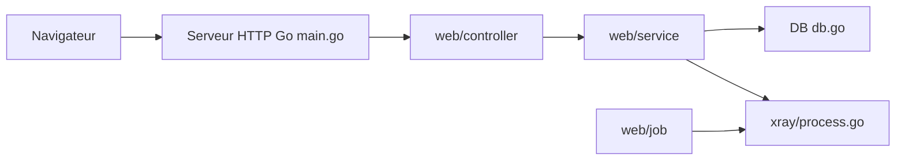

# vaxilu/x-ui

> Web panel for managing a multi-user, multi-protocol Xray proxy server, for server administrators.

## The problem
Configuring Xray by hand (protocols, users, traffic quotas, certificates) is tedious without an interface.

## What it actually does
Monolithic Go application with a web interface: system monitoring, multi-user accounts, vmess, vless, trojan, shadowsocks protocols and more, traffic and expiry limits, an Xray configuration template, HTTPS with a certificate obtained through the Cloudflare DNS API and Let's Encrypt. Data is stored locally (SQLite presumed). The Xray binary is driven as a subprocess. Telegram notifications are announced as "in development". The README is in Chinese.

## How it is wired


## Trying it
```bash
bash <(curl -Ls https://raw.githubusercontent.com/vaxilu/x-ui/master/install.sh)
docker build -t x-ui .
```

## Cost and gotchas
Free. The install script is run as root from the Internet. Last push in August 2024: no visible security follow-up. The README warns that it closes tickets from beginners.

## What it is not
It is not a turnkey VPN nor a tool documented for the enterprise; legal use depends on your country.

## Alternatives
The README mentions v2-ui, from which it allows migration.

## For you
Ignore: outside the data/AI field, unmaintained for over a year, and launched as root with a remote script.
