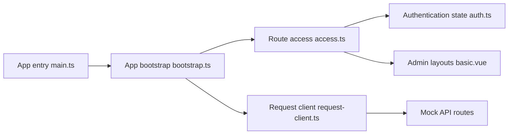

# vbenjs/vue-vben-admin

> Admin application template in Vue 3, Vite and TypeScript, with permissions and themes.

## The problem
Starting an admin interface (login, protected routes, themes, i18n) without starting from scratch.

## What it actually does
Front-office template ready to clone, offered in several variants depending on the UI library. Handles application bootstrap, preferences, authentication, dynamic routes based on permissions, layouts, a dashboard, a request client and a mock API. Version 5.0 is not compatible with earlier ones (v2 branch for the old one).

## How it is wired


## Trying it
```bash
git clone https://github.com/vbenjs/vue-vben-admin.git
cd vue-vben-admin
npm i -g corepack
pnpm install
pnpm dev
pnpm build
```

## Cost and gotchas
Free. The preview's test account is public (vben/123456): never reuse it as is. Documentation mainly in Chinese for the demo site.

## What it is not
Not a back end: the API is mocked. Unrelated to MLOps, except as a dashboard skeleton.

## Alternatives
No alternative named in the README.

## For you
Ignore: generic front-end template; for a model dashboard, a dedicated tool will be faster.
