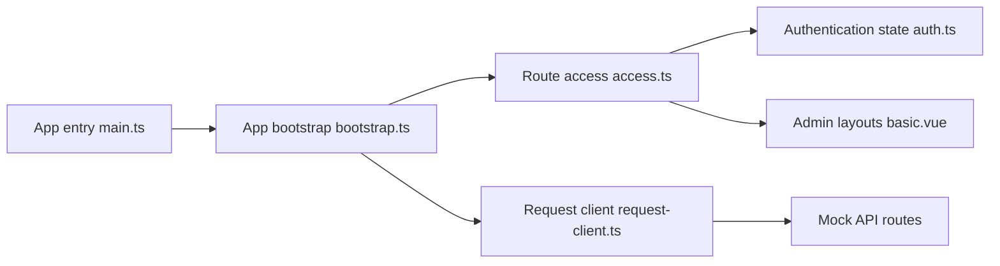

# vbenjs/vue-vben-admin

> Modèle d'application d'administration en Vue 3, Vite et TypeScript, avec permissions et thèmes.

## Le problème
Démarrer une interface d'administration (connexion, routes protégées, thèmes, i18n) sans repartir de zéro.

## Ce que ça fait vraiment
Gabarit de front-office prêt à cloner, proposé en plusieurs variantes selon la bibliothèque d'interface. Gère l'amorçage de l'application, les préférences, l'authentification, les routes dynamiques selon les permissions, des layouts, un tableau de bord, un client de requêtes et une API simulée (mock). La version 5.0 n'est pas compatible avec les précédentes (branche v2 pour l'ancienne).

## Comment c'est branché


## Essayer
```bash
git clone https://github.com/vbenjs/vue-vben-admin.git
cd vue-vben-admin
npm i -g corepack
pnpm install
pnpm dev
pnpm build
```

## Coût et pièges
Gratuit. Le compte de test de l'aperçu est public (vben/123456) : ne jamais le reprendre tel quel. Documentation principalement en chinois pour le site de démonstration.

## Ce que ce n'est pas
Pas un back-end : l'API est simulée. Pas de rapport avec le MLOps, sauf comme squelette de tableau de bord.

## Alternatives
Aucune alternative nommée dans le README.

## Pour toi
À ignorer : gabarit front générique ; pour un tableau de bord de modèles, un outil dédié ira plus vite.

