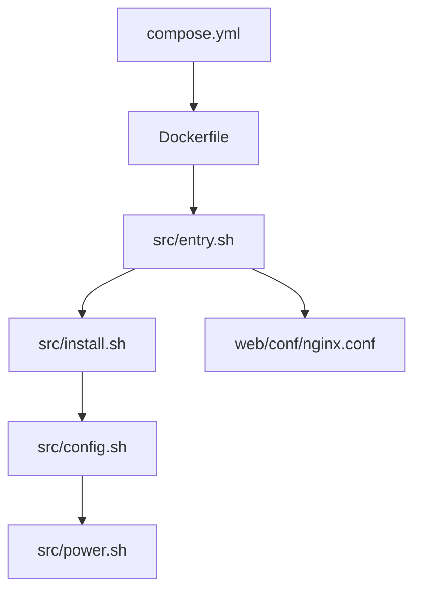

# vdsm/virtual-dsm

> Docker container that runs the Synology DSM NAS system in a KVM virtual machine.

## The problem
Testing or hosting DSM without buying a Synology NAS requires setting up a virtual machine yourself and fetching the installation files.

## What it actually does
The container downloads the DSM installation, starts a KVM-accelerated VM and serves the DSM desktop on port 5000. CPU, RAM, disks (including passthrough) and network (NAT, macvlan, DHCP) are set through environment variables. Version 7.2 by default, a specific version possible via a `.pat` file URL.

## How it is wired


## Trying it
```bash
docker run -it --rm --name dsm -e "DISK_SIZE=256G" -p 5000:5000 --device=/dev/kvm --device=/dev/net/tun --cap-add NET_ADMIN -v "${PWD:-.}/dsm:/storage" --stop-timeout 120 docker.io/vdsm/virtual-dsm
```

## Cost and gotchas
Requires a Linux host with KVM (or Windows 11 with nested virtualization); Docker Desktop on Linux, macOS and Windows 10 is not supported. At least 1 GB of RAM and 16 GB of disk.

## What it is not
It is not an authorized use on any hardware: the README reminds that the Synology EULA forbids DSM outside Synology hardware. Virtual Machine Manager is absent and Surveillance Station includes no free license.

## Alternatives
No alternative named in the README.

## For you
Ignore: unrelated to data or MLOps, and its use outside Synology violates the EULA that the README itself cites.
