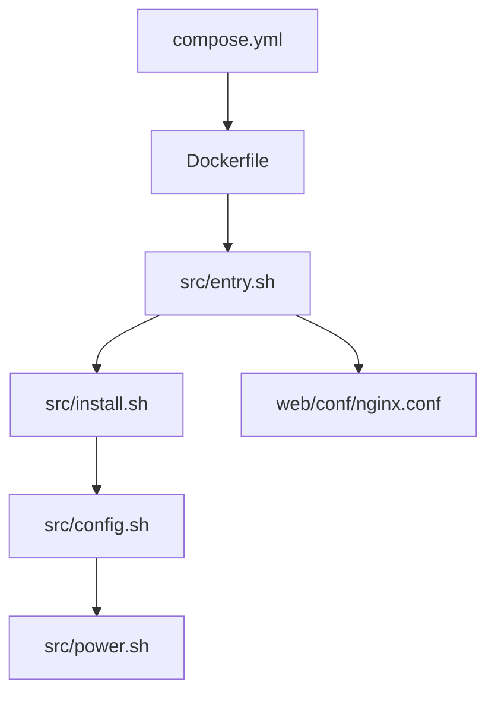

# vdsm/virtual-dsm

> Conteneur Docker qui fait tourner le système NAS Synology DSM dans une machine virtuelle KVM.

## Le problème
Tester ou héberger DSM sans acheter de NAS Synology demande de monter soi-même une machine virtuelle et de récupérer les fichiers d'installation.

## Ce que ça fait vraiment
Le conteneur télécharge l'installation de DSM, démarre une VM accélérée par KVM et sert le bureau DSM sur le port 5000. CPU, RAM, disques (y compris passthrough) et réseau (NAT, macvlan, DHCP) se règlent par variables d'environnement. Version 7.2 par défaut, version précise possible via une URL de fichier `.pat`.

## Comment c'est branché


## Essayer
```bash
docker run -it --rm --name dsm -e "DISK_SIZE=256G" -p 5000:5000 --device=/dev/kvm --device=/dev/net/tun --cap-add NET_ADMIN -v "${PWD:-.}/dsm:/storage" --stop-timeout 120 docker.io/vdsm/virtual-dsm
```

## Coût et pièges
Il faut un hôte Linux avec KVM (ou Windows 11 avec virtualisation imbriquée) ; Docker Desktop sur Linux, macOS et Windows 10 n'est pas supporté. Au moins 1 Go de RAM et 16 Go de disque.

## Ce que ce n'est pas
Ce n'est pas un usage autorisé sur n'importe quel matériel : le README rappelle que l'EULA de Synology interdit DSM hors matériel Synology. Le Virtual Machine Manager est absent et Surveillance Station n'inclut aucune licence gratuite.

## Alternatives
Aucune alternative nommée dans le README.

## Pour toi
À ignorer : sans rapport avec la donnée ou le MLOps, et son usage hors Synology viole l'EULA que le README cite lui-même.

