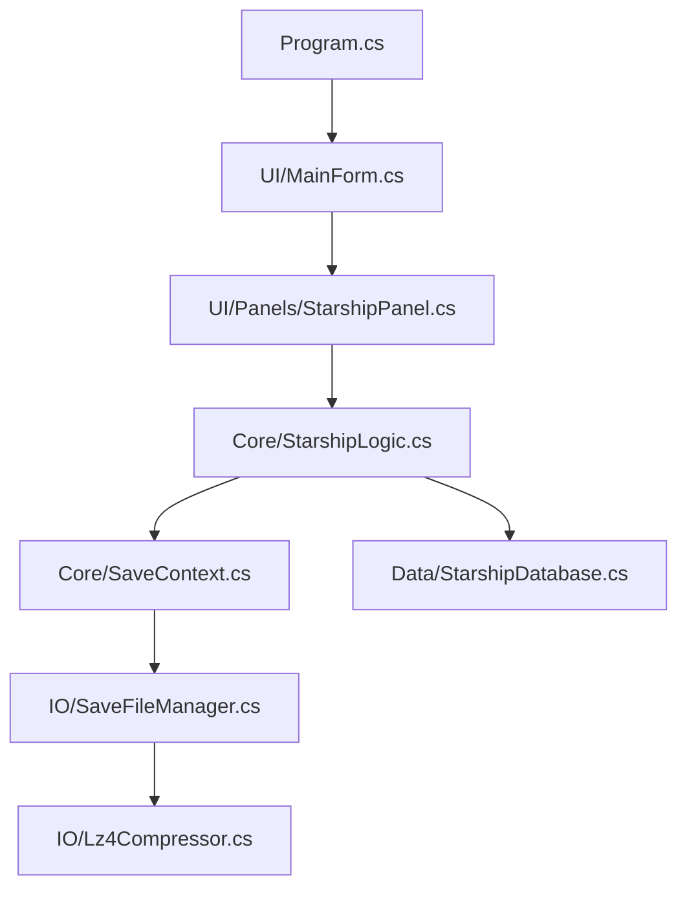

# vectorcmdr/NMSE

> Windows desktop editor for modifying No Man's Sky game saves, aimed at players.

## The problem
The game's saves are compressed and unreadable by hand: editing inventory, ships or companions requires a dedicated tool.

## What it actually does
C# WinForms application: it loads the save (LZ4 decompression, JSON parsing), then panels edit player, bases, companions, ships and inventories. The game databases are embedded JSON files. Import/export, backups and a raw JSON editor are provided.

## How it is wired


## Trying it
```bash
git clone https://github.com/vectorcmdr/NMSE.git
cd NMSE
dotnet restore
dotnet build
dotnet test NMSE.Tests/
```

## Cost and gotchas
Free. Building requires the .NET 10 SDK; on Linux and macOS the application runs through Wine (AppImage or DMG provided).

## What it is not
Not a data or AI tool: it is a cheat editor for a game. The user guide may lag behind versions, and the AGPL license imposes its conditions on modified redistribution.

## Alternatives
No alternative named in the README.

## For you
Ignore: a game save editor has no use in data, AI or MLOps work.
