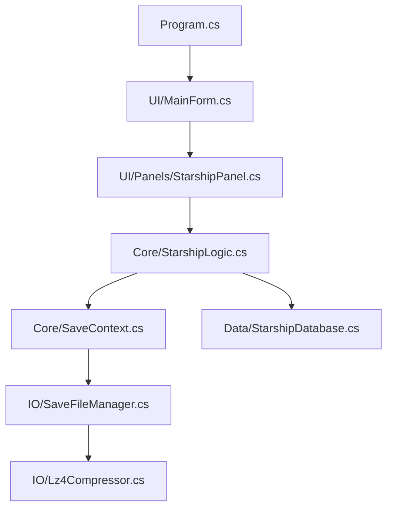

# vectorcmdr/NMSE

> Éditeur de bureau Windows pour modifier les sauvegardes du jeu No Man's Sky, destiné aux joueurs.

## Le problème
Les sauvegardes du jeu sont compressées et illisibles à la main : modifier inventaire, vaisseaux ou compagnons demande un outil dédié.

## Ce que ça fait vraiment
Application WinForms en C# : elle charge la sauvegarde (décompression LZ4, analyse JSON), puis des panneaux éditent joueur, bases, compagnons, vaisseaux et inventaires. Les bases de données du jeu sont des fichiers JSON embarqués. Import/export, sauvegardes de secours et éditeur JSON brut sont fournis.

## Comment c'est branché


## Essayer
```bash
git clone https://github.com/vectorcmdr/NMSE.git
cd NMSE
dotnet restore
dotnet build
dotnet test NMSE.Tests/
```

## Coût et pièges
Gratuit. La compilation exige le SDK .NET 10 ; sous Linux et macOS l'application passe par Wine (AppImage ou DMG fournis).

## Ce que ce n'est pas
Pas un outil data ou IA : c'est un éditeur de triche pour un jeu. Le guide utilisateur peut être en retard sur les versions, et la licence AGPL impose ses conditions en cas de redistribution modifiée.

## Alternatives
Aucune alternative nommée dans le README.

## Pour toi
À ignorer : un éditeur de sauvegardes de jeu n'a aucun usage dans un travail data, IA ou MLOps.

