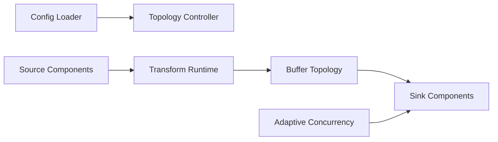

# vectordotdev/vector

> Observability data pipeline in Rust, to collect, transform and route logs and metrics.

## The problem
Log agents are fragmented, expensive and vendor-locked; changing backend breaks the flows.

## What it actually does
Deployed as an agent or aggregator, Vector reads sources, transforms (VRL, remap, dedupe, filters), applies buffers, then sends to sinks (S3, Elasticsearch, ClickHouse, GCS…). Adaptive concurrency on sinks, gRPC API and a "tap" to inspect the flow. Maintained by Datadog's open-source team. The performance figures are the author's own.

## How it is wired

## Trying it
No installation command in the README: it points to the quickstart guide on vector.dev (not documented here).

## Cost and gotchas
Free. Metrics in beta, traces "coming soon" according to the README. More than 2,500 open issues.

## What it is not
Not an analysis or storage tool: it routes, it visualizes nothing. The comparison table comes from the author.

## Alternatives
Filebeat, Fluent Bit, Fluentd, Logstash, Splunk UF/HF, Telegraf (compared in the README).

## For you
Keep an eye on it: useful if you operate MLOps platforms with lots of logs and metrics, otherwise superfluous.
